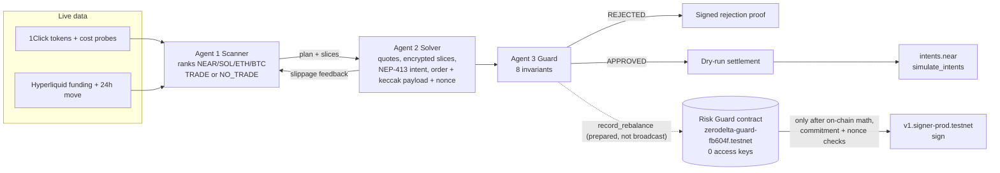

# ZeroDelta

**ZeroDelta is an autonomous cross-chain carry-strategy prototype whose NEAR Risk Guard contract enforces risk limits before authorizing MPC signatures over committed order parameters.**

▶ **Live demo:** [zerodelta.vercel.app](https://zerodelta.vercel.app/) (no wallet needed) · **Judge guide:** [docs/JUDGE_GUIDE.md](docs/JUDGE_GUIDE.md) · **Primary track:** 06 / SEC AI Security & Defense

**Proof on NEAR testnet** (contract [`zerodelta-guard-fb604f.testnet`](https://testnet.nearblocks.io/address/zerodelta-guard-fb604f.testnet), 0 access keys):
[contract calls the MPC signer after its checks](https://testnet.nearblocks.io/txns/DZaDDUGQQLBkdZHiZxn95NtrmeUiGrd3a7af4hn37JfV) ·
[spoofed payload rejected](https://testnet.nearblocks.io/txns/4PpxYCPEqwtLnuGR6i1Te2wWvs3Ynb94KqqqphEvbSHq) ·
[rogue 10x rejected](https://testnet.nearblocks.io/txns/H46fyRHiFoVrY6L3k9758ceRB6bhfT9v4onqZKkbonQo) ·
[replay rejected](https://testnet.nearblocks.io/txns/3rQrPFjByJmK676YJyX7v785unoSr6FanWTdrKfXqSff) ·
[deploy + lock](https://testnet.nearblocks.io/txns/12skMoFQC6sNfB6YNqmpEiK8DCQUWYFPcDLNoAvXM5Lx)

| Question | Answer |
|---|---|
| What is it? | Three cooperating, deterministic agents (scanner, confidential solver, risk guard) that find, size and check delta-neutral funding-carry trades across NEAR, Solana, Arbitrum, Bitcoin and Hyperliquid, plus a locked NEAR contract that is the only path to the treasury's signing key. |
| What problem? | An AI agent with a treasury key can lose everything on one hallucinated or hijacked trade. Spending limits in the agent's own code don't help if the agent is the thing that's compromised. |
| Why NEAR? | Chain Signatures derives a key per *calling account*, and a NEAR contract can be that caller and can delete all its access keys. So a smart contract, not a person or agent, holds signing authority, and its rules can't be changed. |
| What is implemented? | The contract (deployed, locked, 33 Rust tests), real NEP-413 intents checked by `intents.near`, live 1Click and Hyperliquid data, the agent pipeline, and a harness that re-verifies everything. |
| What does the demo prove? | A compromised solver that lies about its order is caught off-chain and by the contract's own `check_order_params`; the same attack, a rogue 10x trade and a replay all failed as real testnet transactions without producing an MPC signature. |
| What is not implemented? | No funds move and no trade executes. The signature covers an order commitment, not a Hyperliquid order. The TEE is simulated. See [Limitations](#limitations). |
| How do I reproduce it? | `npm ci && npm test && npm run verify && npm run build` (and `cargo test` in `contracts/risk-guard`). See [Quick start](#quick-start). |

---

## Flagship security demonstration

Click **Simulate Compromised Solver (Spoofed Metrics)** on the [demo](https://zerodelta.vercel.app/). The solver reports a hedged order (≈0% delta, ~1.3x) but its MPC payload commits to 100% spot + a 9x perp long (≈1000% delta, 10x), and its encrypted slices spend the whole treasury. The page shows side by side:

| Solver claim | Actual payload | Risk Guard decision | Contract evidence |
|---|---|---|---|
| net delta 0.00%, leverage ≈1.3x | net delta ≈1000%, leverage 10x | **REJECTED**: `ORDER_PAYLOAD_BINDING` (`PAYLOAD_COMMITMENT_MISMATCH`), `ENVELOPE_INTEGRITY` | Live `check_order_params` on the deployed contract: `PAYLOAD_COMMITMENT_MISMATCH`. Historical: the same attack sent on-chain [failed](https://testnet.nearblocks.io/txns/4PpxYCPEqwtLnuGR6i1Te2wWvs3Ynb94KqqqphEvbSHq) with no MPC receipt. |

Delta and leverage pass on the claim; the fingerprint check is what refuses to trust it.

### Why this is not just another AI trading bot
Most agent "guardrails" are checks in the same process that holds the key. Here the agents hold no key. The only code that can request a signature for the hedge key is a public, hash-verified, keyless contract that recomputes the risk itself, so a compromised agent or server can at worst submit orders the policy allows (see the trusted inputs in [SECURITY_MODEL.md](docs/SECURITY_MODEL.md)).

---

## NEAR-specific architecture



- **Chain Signatures:** `v1.signer-prod.testnet` derives the hedge key from `(predecessor, path)`. The predecessor is the contract, so the key ([`0x9d5A…754dD`](https://testnet.nearblocks.io/txns/DZaDDUGQQLBkdZHiZxn95NtrmeUiGrd3a7af4hn37JfV)) is usable only through `record_rebalance`.
- **Keyless account:** the deploy transaction deleted the contract account's only full-access key. Policy, solver and code are immutable.
- **NEAR Intents:** spot legs are priced with live 1Click dry quotes and the swarm's NEP-413 `token_diff` intent is executed by the real `intents.near` contract via `simulate_intents` (signature accepted, then stops at the balance check for the unfunded demo account).

---

## Real deployed proof (NEAR testnet)

All values are in [`testnet-proof.json`](testnet-proof.json) and re-checked by `npm run verify` §9 against an archival RPC.

| What | Value |
|---|---|
| Risk Guard v2 contract (locked, 0 access keys) | [`zerodelta-guard-fb604f.testnet`](https://testnet.nearblocks.io/address/zerodelta-guard-fb604f.testnet) |
| Solver (only allowed caller) | [`zerodelta-solver-fb604f.testnet`](https://testnet.nearblocks.io/address/zerodelta-solver-fb604f.testnet) |
| Immutable policy | `max_delta_bps 200`, `max_leverage_x100 300`, `max_slippage_bps 25` |
| Code hash | `6VqcNeQLfWWN7XyFHbvhZJoDoZLNQMEsgRpapn1jJEqk` = sha256 of the committed [`zerodelta_risk_guard.wasm`](contracts/risk-guard/res/zerodelta_risk_guard.wasm) |
| Hedge key (derived for the contract, path `zerodelta/hedge/arbitrum`) | `0x9d5A25917b23C1CF60fD5c7695621FD3Dca754dD` |

| # | Transaction | Result | Nearblocks |
|---|---|---|---|
| 1 | Deploy, `new` (policy, solver, MPC target), **delete the only access key**, in one transaction | ✅ Success | [12skMoFQ…vXM5Lx](https://testnet.nearblocks.io/txns/12skMoFQC6sNfB6YNqmpEiK8DCQUWYFPcDLNoAvXM5Lx) |
| 2 | Solver sends the approved raw order (NEAR, spot $33,273.35 / short $33,273.35 on $50,000). Contract computes 0 bps / 1.34x, checks keccak256(order) and the nonce, stores attestation #0, then **itself** calls `v1.signer-prod.testnet.sign` and stores the signature | ✅ Success; receipt `zerodelta-guard-fb604f.testnet → v1.signer-prod.testnet.sign` | [DZaDDUGQ…n37JfV](https://testnet.nearblocks.io/txns/DZaDDUGQQLBkdZHiZxn95NtrmeUiGrd3a7af4hn37JfV) |
| 3 | Rogue 10x order (spot $49,846 + perp long $450,000), honest payload. Net delta **99,970 bps (at time of tx)**, 10.00x | ❌ Fails on purpose: `DELTA_NEUTRALITY`, `LEVERAGE_CEILING`; no MPC receipt | [H46fyRHi…kbonQo](https://testnet.nearblocks.io/txns/H46fyRHiFoVrY6L3k9758ceRB6bhfT9v4onqZKkbonQo) |
| 4 | Approved, delta-neutral numbers with a fresh nonce but the payload of a 10x long | ❌ Fails on purpose: `PAYLOAD_COMMITMENT_MISMATCH`; no MPC receipt | [4PpxYCPE…EvbSHq](https://testnet.nearblocks.io/txns/4PpxYCPEqwtLnuGR6i1Te2wWvs3Ynb94KqqqphEvbSHq) |
| 5 | Byte-identical replay of tx 2 | ❌ Fails on purpose: `NONCE_ALREADY_USED`; no MPC receipt | [3rQrPFjB…fXqSff](https://testnet.nearblocks.io/txns/3rQrPFjByJmK676YJyX7v785unoSr6FanWTdrKfXqSff) |

Rogue figures in fresh dry runs differ slightly from tx 3 (e.g. 99,996 vs 99,970 bps) because quotes are live. The superseded v1 contract (`zerodelta-guard-05eb36.testnet`) trusted solver metrics and let a keyed account call the signer directly; its transactions are kept under `previousDeployment` for history only.

---

## Quick start

```bash
git clone https://github.com/g4stein/zerodelta.git && cd zerodelta
npm ci                 # Node.js >= 20.9, no API keys
npm run dev            # http://localhost:3000
```

On the page: **do** click the green button **→ see** the market ranking, the Agent 1/2 negotiation, 8 passing checks and the contract's verdict. **Do** click the amber button **→ see** the claim-vs-payload panel and `PAYLOAD_COMMITMENT_MISMATCH`. **Do** open the *On-chain proof (testnet)* tab **→ see** the five transactions re-verified live.

## Reproducible tests

Results of the latest full run. [`verify-report.json`](verify-report.json) is that run's machine-readable output: its `source.commit` is the commit the run started from, with `dirty: true` and a hash of the uncommitted diff, because a report can't name the commit that contains it. For a report bound to one exact commit, use the CI artifact `verify-report-offline-<sha>`.

| Command | Result | Network |
|---|---|---|
| `npm run typecheck` | clean | none |
| `npm test` | **100 tests**, 3 files: [`swarm.test.ts`](tests/swarm.test.ts), [`adversarial.test.ts`](tests/adversarial.test.ts), [`hyperliquid.test.ts`](tests/hyperliquid.test.ts) | none (fetch mocked where used) |
| `cd contracts/risk-guard && cargo test` | **33 tests**: 18 unit tests in `src/lib.rs` + 15 in [`tests/adversarial.rs`](contracts/risk-guard/tests/adversarial.rs) | none (Rust 1.81) |
| `npm run verify:offline` | **22 pass, 25 skipped** (live-only) | none |
| `npm run verify` | **57 checks**, read-only | public NEAR RPC, 1Click, Hyperliquid |
| `npm run build` | clean | none |

What each layer covers and how to read the report: [docs/VERIFICATION.md](docs/VERIFICATION.md). CI ([`.github/workflows/verify.yml`](.github/workflows/verify.yml)) runs typecheck, tests, build, offline verification and the Rust tests on every push; live verification is a separate manual job because public RPC availability is outside this repo's control.

## Attack demonstrations

| Attack | Off-chain (Agent 3) | On-chain (contract) | Tested in |
|---|---|---|---|
| Rogue 10x directional long | `DELTA_NEUTRALITY`, `LEVERAGE_CEILING` | same, from raw legs; [failed tx](https://testnet.nearblocks.io/txns/H46fyRHiFoVrY6L3k9758ceRB6bhfT9v4onqZKkbonQo) | Vitest, Rust, verify |
| Compromised solver: hedged claim, 10x payload, slices spend the treasury | `ORDER_PAYLOAD_BINDING`, `ENVELOPE_INTEGRITY` | `PAYLOAD_COMMITMENT_MISMATCH`; [failed tx](https://testnet.nearblocks.io/txns/4PpxYCPEqwtLnuGR6i1Te2wWvs3Ynb94KqqqphEvbSHq) | Vitest, Rust, verify |
| Any order field changed after commitment (asset, notional, collateral, treasury, slippage, nonce, contract id) | `ORDER_PAYLOAD_BINDING` | `PAYLOAD_COMMITMENT_MISMATCH` | Rust `changing_any_field_after_commitment_breaks_the_payload` |
| Solver inflates the treasury or switches asset vs the request | `ORDER_PAYLOAD_BINDING` (`TREASURY_MISMATCH`, `ASSET_MISMATCH`) | not detectable on-chain (trusted input) | Vitest |
| Replay / older nonce | `REPLAY_AND_MPC_GATE` | `NONCE_ALREADY_USED`; [failed tx](https://testnet.nearblocks.io/txns/3rQrPFjByJmK676YJyX7v785unoSr6FanWTdrKfXqSff) | Vitest, Rust, verify |
| Stale or future-dated order | `REPLAY_AND_MPC_GATE` (`STALE_ORDER`, `FUTURE_NONCE`) | not enforced (finding F-1) | Vitest |
| Unauthorized caller, incl. the guard account | n/a | `UNAUTHORIZED_SOLVER` | Rust |
| Zero / inflated collateral, invalid symbol, u64 extremes, rounding edges | `INVALID_ORDER` | `INVALID_ORDER`, ceil rounding, u128 saturation | Rust |
| Forged NEP-413 signature, wrong recipient, wrong signer, tampered/dropped slice, forged or stale attestation | `NEP413_SIGNATURE`, `ENVELOPE_INTEGRITY`, `TEE_ATTESTATION` | n/a | Vitest, verify |
| RPC down, malformed or rate-limited | fails closed: contract reads return "unavailable", and if the contract's `last_nonce` can't be read the run is REJECTED (`ONCHAIN_NONCE_UNAVAILABLE`) | n/a | Vitest (mocked fetch) |

## Agent architecture

The agents are deterministic TypeScript modules with separate responsibilities, not LLMs. Their autonomy is in choosing markets, sizing, and negotiating with each other from live data.

- **Agent 1, scanner** ([`scannerAgent.ts`](src/lib/agents/scannerAgent.ts)): for every candidate, gross carry = Hyperliquid hourly funding × 8,760; round trip = 2 × live 1Click entry cost ($100 reference quote: spread + fees) + 2 × 4.5 bps perp taker fee; net carry = gross − round trip amortised over 30 days. Ranks the matrix, picks #1 (or records a manual override), chooses hedge leverage (1–2x, liquidation ≥ 10 daily moves away) and a slice count from a live $10k probe quote. Returns **NO_TRADE** when the chosen market has no positive net carry or live data is missing; the orchestrator then withholds settlement and the sign request unless the demo override is ticked, and labels the run accordingly. Reported treasury APR = net carry × spot fraction (≈ two-thirds at 2x), i.e. on the whole treasury.
- **Agent 1 ↔ Agent 2 negotiation** ([`orchestrator.ts`](src/lib/swarm/orchestrator.ts)): if a slice's slippage exceeds 10 bps, `SOLVER_SLIPPAGE_FEEDBACK` → `SCANNER_RESLICE_ADJUSTMENT` with `slices × (observed / target)²`, up to 3 reslices, all in the hash-chained audit trail.
- **Agent 2, solver** ([`solverAgent.ts`](src/lib/agents/solverAgent.ts)): live quotes, hedge sized to the quoted fill, encrypted TWAP slices (`nacl.box`), NEP-413 intent, raw order in cents, keccak256 payload, time-based nonce, (simulated) attestation bound to all of them.
- **Agent 3, guard** ([`guardianAgent.ts`](src/lib/agents/guardianAgent.ts)): delta, leverage, slippage, TEE attestation, NEP-413 intent, envelope integrity, order-to-payload binding (incl. trusted treasury/pair), anti-replay (exact nonce set, on-chain `last_nonce`, 5-minute freshness) and guard-gated MPC routing. It prepares the `record_rebalance` call, never a direct MPC call.

## Security model

Full threat model: [docs/SECURITY_MODEL.md](docs/SECURITY_MODEL.md). In short, the contract enforces caller, hash format, order validity, delta, leverage, slippage ceiling, payload commitment, nonce, and deposit/gas rules, and only then calls the MPC signer. It **trusts** the solver's treasury size, collateral and slippage figures, because it cannot see balances or prices. Open findings in the immutable contract: **F-1** a stolen solver key could set `nonce = u64::MAX` and block all future orders; **F-2** it could fill the contract's storage (≈ 600 attestations of headroom). Neither moves funds.

## Real versus simulated

| Component | Status |
|---|---|
| Risk Guard contract, policy, lock, 5 transactions, contract-originated MPC signature | **Real on NEAR testnet** (historical proof, re-verified live) |
| `check_order_params` on every dashboard run | **Live read-only check** |
| NEAR RPC, `intents.near` `simulate_intents` (mainnet), 1Click tokens and quotes, Hyperliquid funding | **Live** |
| NEP-413 signing, nacl.box slice encryption, keccak256 commitments, secp256k1 signature recovery | **Real cryptography** |
| Settlement | **Simulated execution**: dry run, nothing broadcast, no funds |
| TEE enclave and attestation | **Software-simulated** (real hashes and signatures, no hardware root of trust) |
| Hyperliquid order signing | **Offline readiness module only**, matched to the official SDK's test vectors; nothing is submitted ([details](docs/HYPERLIQUID_EXECUTION_PATH.md)) |
| Yield | **Estimates** from live funding and costs; funding changes hourly and can turn negative |

## Limitations

- No real trades or fund movement; the demo account is unfunded and dashboard clicks never create transactions.
- The MPC signature is over a ZeroDelta order commitment, not an executable Hyperliquid action.
- Trusted inputs (treasury, collateral, slippage) and findings F-1, F-2, F-3 in [SECURITY_MODEL.md](docs/SECURITY_MODEL.md).
- Hyperliquid market indices are hard-coded from 2026-11-09; one live quote is scaled to all slices.
- Off-chain approved-nonce memory is per server instance; the contract's `last_nonce` is the real replay barrier.

## Future production pathway

1. A v3 contract that recomputes the Hyperliquid action hash and EIP-712 digest on-chain and signs *that*, with oracle price bands and block-time nonces ([plan](docs/HYPERLIQUID_EXECUTION_PATH.md)).
2. Read treasury balances on-chain instead of trusting the solver; require storage deposits; DAO-controlled timelocked upgrades.
3. Real TEE attestation (NEAR AI Cloud / Phala TDX) verified against vendor collateral.
4. Funded execution through `intents.near` and Hyperliquid, after an external audit.

## Hackathon track relevance

| Track | Fit |
|---|---|
| **06 / SEC AI Security & Defense** (primary) | Policy engine enforced by a keyless contract, payload commitments, replay protection, guard-gated Chain Signatures, public attack transactions. |
| 01 / DFI Unstoppable DeFi | Funding-carry strategy over NEAR Intents and Chain Signatures (dry run). |
| 05 / SWM AI Swarms | Three specialised agents; scanner and solver negotiate slice size from live feedback; the guard checks both. |
| 04 / BUS Autonomous Business | Treasury that ranks markets, sizes itself, says NO_TRADE when nothing pays, and leaves an audit trail. |
| 07 / AGT Agent Economy | Agents act on treasury value only within contract-enforced limits. |
| 03 / PRV Privacy & Private AI | Encrypted order slices; the TEE is a simulated prototype boundary, so this fit is partial. |

## Built with, and disclosure

Next.js 16, React 19, Tailwind 4, near-api-js 7, near-sdk 5.5 (Rust), tweetnacl, @noble/hashes, @noble/curves, @msgpack/msgpack, bs58, lucide-react, Vitest, tsx. All code was written during the hackathon window (first commit 2026-11-08) with an AI coding agent (Kiro); the hackathon rules allow AI-written code and libraries (HACKATHON.md Q-005). If the author submits a second NEAR HACKATHON project, both READMEs must name each other (Q-015).

**Repo map:** contract [`contracts/risk-guard/`](contracts/risk-guard/) · agents [`src/lib/agents/`](src/lib/agents/) · NEAR integration [`src/lib/near/`](src/lib/near/) · Hyperliquid readiness [`src/lib/hyperliquid/`](src/lib/hyperliquid/) · API [`src/app/api/swarm/route.ts`](src/app/api/swarm/route.ts) · UI [`src/app/page.tsx`](src/app/page.tsx) · harness [`scripts/verify-hackathon.ts`](scripts/verify-hackathon.ts) · setup [`scripts/testnet-setup.ts`](scripts/testnet-setup.ts) · docs [`docs/`](docs/)

### API

`GET /api/swarm` returns live telemetry plus the contract's state and the re-verified proof transactions. `POST /api/swarm` with `{ "mode": "rebalance" | "rogue" | "spoofed_metrics", "treasuryUsd": 10000–1000000, "pair": "AUTO" | "NEAR" | "SOL" | "ETH" | "BTC", "sliceCount": "auto" | 1–24, "simulateUnprofitable": true }` runs the swarm (input is clamped; only boolean `true` enables the override).

```bash
curl -s https://zerodelta.vercel.app/api/swarm | jq '{contract: .onchain.contractId, locked: .onchain.guard.locked, allVerified: .onchain.allVerified}'
curl -s -X POST https://zerodelta.vercel.app/api/swarm -H 'content-type: application/json' -d '{"mode":"spoofed_metrics"}' \
  | jq '{decision: .guardian.decision, violations: .guardian.violations, contract: .onchainCheck.violations}'
curl -s -X POST https://zerodelta.vercel.app/api/swarm -H 'content-type: application/json' -d '{"mode":"rebalance","pair":"AUTO"}' \
  | jq '{economics, decision: .guardian.decision, pair: .resolved.pair, negotiation: [.negotiation[] | {sliceCount, observedSlippageBps, action}]}'
```

## License
MIT
