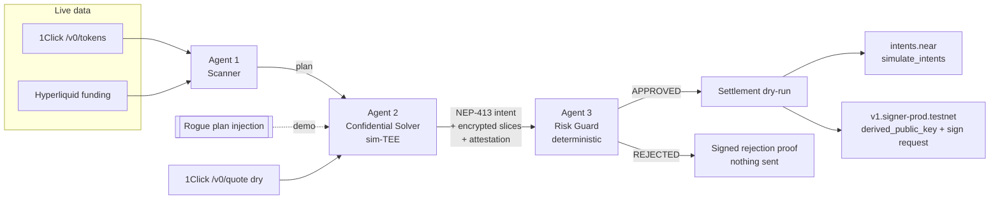

# ZeroDelta

**A 3-agent swarm that plans, confidentially solves, and risk-guards delta-neutral cross-chain rebalances on NEAR.**

**▶ Live demo: [zerodelta.vercel.app](https://zerodelta.vercel.app/)** — no wallet or install needed. Click the green button for an approved rebalance and the red button to watch the Risk Guard block a rogue trade.

ZeroDelta lets a DAO or AI-run treasury earn perp funding carry (spot long + equal perp short, net delta ≈ 0) across NEAR, Solana, Arbitrum and Hyperliquid without giving an AI agent unrestricted keys. An AI planner can propose anything. A deterministic risk guard checks the math before any NEAR Intent or Chain Signature is authorized.

The live API can also be called directly: `GET https://zerodelta.vercel.app/api/swarm` returns live NEAR telemetry, and `POST` with `{"mode":"rebalance"}` or `{"mode":"rogue"}` runs the full swarm (see [API](#api-srcappapiswarmroutets)).

| Track | How ZeroDelta fits |
|---|---|
| **[01 / DFI] Unstoppable DeFi** | Funding-rate carry built on NEAR Intents (`intents.near`, 1Click API) with the hedge leg controlled by NEAR Chain Signatures. |
| **[03 / PRV] Privacy & Private AI** | The solver slices orders inside a (simulated) TEE and encrypts each slice with `nacl.box`. Only ciphertext and SHA-256 commitments are public, so the mempool can't see order size or timing. |
| **[04 / BUS] Autonomous Business** | A treasury runs itself: it scans funding, sizes positions, signs intents and leaves a hash-chained, signed audit trail. |
| **[05 / SWM] AI Swarms** | Three specialised agents (Scanner, Confidential Solver, Risk Guard) coordinate through signed, attested hand-offs. |

---

## One-command verification (for automated judges)

```bash
npm install
npm test          # 34 deterministic offline unit tests (Vitest)
npm run verify    # 29 live end-to-end checks against real NEAR, intents.near, 1Click, Hyperliquid
npm run build     # production Next.js build, zero TS errors
npm run dev       # open http://localhost:3000
```

Requirements: Node.js ≥ 20.9. No API keys, wallets, Docker or Rust needed.

The hosted demo is a convenience. `npm run verify` is the complete, reproducible check of every claim in this README.

`npm run verify` exits `0` only if every check passes and writes `verify-report.json`. Levels: `PASS`, `WARN` (a live source was unreachable and a labelled fallback was used), `SKIP` (offline mode), `FAIL` (exit code 1). With no internet, run `ZERODELTA_OFFLINE=1 npm run verify`, which skips the live sections and says so.

Sample output (abridged, real run on 2026-11-08):

```
▸ 2. Live NEAR JSON-RPC
  ✔ PASS  testnet status + gas price  — block #276819744 GwePAh5S… · gas 100000000
  ✔ PASS  view_account intents.near (mainnet)  — contract code BtA1BEFN…
  ✔ PASS  view_account v1.signer-prod.testnet (testnet)  — contract code CpGX8ywX…
▸ 3. NEAR Chain Signatures MPC (v1.signer-prod.testnet)
  ✔ PASS  MPC contract version + root public key  — v3.18.0, 4 domains
  ✔ PASS  derived_public_key → hedge EVM address  — … → 0x903428c9758364DC0c2d35E5c79467BF6ccCcee2
▸ 4. Live intents.near Verifier (simulate_intents on mainnet)
  ✔ PASS  Signed NEP-413 auth probe executes  — intent_hash 7Eg24dgZ…
  ✔ PASS  Tampered signature rejected by contract  — INVALID_SIGNATURE: invalid signature
  ✔ PASS  token_diff rebalance intent passes signature check  — SIGNATURE_ACCEPTED_UNFUNDED
▸ 5. Live NEAR Intents 1Click API
  ✔ PASS  GET /v0/tokens  — 216 assets across 39 chains
  ✔ PASS  POST /v0/quote (dry)  — 1000 USDC → 273.30 wNEAR
▸ 8. Full live 3-agent swarm (dry-run settlement)
  ✔ PASS  Delta-neutral rebalance ($50,000)  — APPROVED; net delta 0.00%, leverage 1.00x
  ✔ PASS  Rogue AI directional gamble  — REJECTED; net delta 1000%, leverage 10.00x
Summary  29 passed · 0 warnings · 0 skipped · 0 failed
ALL CHECKS PASSED
```

---

## What is real and what is simulated

Being exact about this matters more than sounding impressive.

| Component | Status | Evidence |
|---|---|---|
| NEAR RPC (blocks, gas, accounts) on testnet + mainnet | **Live** | `src/lib/near/rpcClient.ts`, verify §2 |
| NEP-413 serialisation + Ed25519 signing | **Real cryptography** | Byte-identical to near-api-js `KeyPairSigner.signNep413Message` (test + verify §1) |
| Signed intents checked by the real `intents.near` contract | **Live mainnet dry-run** via `simulate_intents` view call | Valid sig → executes / stops at balance check; tampered sig → `invalid signature` (verify §4) |
| 1Click token list and quotes | **Live** (`dry: true`, no deposit address, no JWT) | verify §5 |
| Funding rates | **Live** Hyperliquid public `info` endpoint | verify §6 |
| Chain Signatures hedge address | **Live** `derived_public_key` view on `v1.signer-prod.testnet` → EIP-55 EVM address | verify §3 |
| Chain Signatures `sign()` call | **Prepared, not broadcast.** It needs a funded testnet account and a deposit. The exact call args are shown in the UI. | `mpcSignRequest` in `guardianAgent.ts` |
| TEE enclave + attestation | **Software-simulated.** Real SHA-256 measurement, Ed25519 report signature, report-data binding and freshness checks, but no hardware root of trust. In production this would be an Intel TDX quote from NEAR AI Cloud / Phala. | `src/lib/crypto/attestation.ts` |
| Order-slice encryption | **Real** X25519-XSalsa20-Poly1305 (`tweetnacl` box) | `solverAgent.ts`, `guardianAgent.ts` |
| Fills / funds movement | **None.** Each run uses a fresh, unfunded implicit account. | — |

**Yield, honestly:** at the funding rates fetched on 2026-11-08, Hyperliquid paid shorts about 7–11% APR on the hedge notional. A 1x 50/50 structure earns that on half the treasury, so about 3.5–5.5% APR on the whole treasury, before execution costs (16–52 bps one-way in live quotes). Funding changes every hour and can go negative. The scanner shows the live figure; it does not promise a number.

---

## Architecture



### Agent 1 — Opportunity & Funding Scanner (`src/lib/agents/scannerAgent.ts`)
- Pulls the live 1Click token list (216 assets across 39 chains at time of writing) for spot prices and routable assets such as `nep141:wrap.near`, `nep141:sol.omft.near` and `nep141:arb.omft.near`.
- Pulls live hourly funding for NEAR, SOL, ETH and BTC perps, annualises it (`hourly × 24 × 365`), and computes basis (perp mark vs NEAR Intents spot).
- Proposes the plan: 50% of treasury buys spot via NEAR Intents, 50% moves as USDC margin to Arbitrum/Hyperliquid, and a perp short of equal notional is opened.

### Agent 2 — Confidential TEE Solver & NEP-413 Intent Crafter (`src/lib/agents/solverAgent.ts`)
- Gets a live 1Click dry quote for one real slice plus a $100 reference quote at the same moment. Slippage = how much worse the slice rate is than the reference rate. All-in cost (spread + fee) is reported separately.
- Sizes the hedge short to the **quoted** spot fill, so the executable plan has net delta exactly 0.
- Splits the spot order into N equal TWAP slices and encrypts each to the guard's X25519 key. Public: ciphertext and `sha256(slice)` commitments only.
- Signs a NEP-413 `token_diff` intent for `intents.near` with a fresh `near-api-js` `KeyPairEd25519`. The signer is the 64-hex implicit account of that key.
- Issues an attestation: `measurement = sha256(canonical(solver manifest))`, `report_data = sha256({envelopeHash, intentPayloadHash, planHash})`, signed with the enclave's Ed25519 key.
- If the quote API is unreachable it falls back to a deterministic local quote model labelled `local-fallback`.

### Agent 3 — Deterministic Risk Policy Guard (`src/lib/agents/guardianAgent.ts`)
Plain code, no LLM. It recomputes everything itself:

| # | Invariant | Rule |
|---|---|---|
| 1 | Delta neutrality | `abs(Σ leg delta USD) / treasuryUSD ≤ 0.02` (equals `abs(spotLong − perpShort) / treasury` when only those legs exist) |
| 2 | Leverage ceiling | `Σ abs(spot + perp notional) / collateralUSD ≤ 3.0` |
| 3 | Slippage ceiling | `max slice slippage ≤ 25 bps` |
| 4 | TEE attestation | valid Ed25519 signature, measurement on allowlist, pinned enclave key, report data bound to this exact intent/envelope/plan, age ≤ 5 min |
| 5 | NEP-413 signature | verified by both tweetnacl and near-api-js; recipient `intents.near`; `signer_id` = implicit account of the key; deadline in the future; `token_diff` matches quoted spend |
| 6 | Envelope integrity | every slice decrypts, matches its commitment, and slices sum to the order |

The guard signs the decision record (approval or rejection proof). Only on approval does it build the Chain Signatures request:

```json
{ "contractId": "v1.signer-prod.testnet", "methodName": "sign",
  "args": { "request": { "payload_v2": { "Ecdsa": "<keccak256(hedge order) hex>" },
                         "path": "zerodelta/hedge/arbitrum", "domain_id": 0 } },
  "attachedDepositYocto": "1", "status": "PREPARED_NOT_BROADCAST" }
```

**The rogue demo:** the injected plan is 100% of treasury in spot plus a 9x perp long, with no hedge. Agent 2 still signs and attests it correctly, so all cryptographic checks pass. The guard rejects it on the math alone: net delta ≈ 1000%, leverage ≈ 10x. The intent is never sent and no MPC request exists.

### Orchestrator (`src/lib/swarm/orchestrator.ts`)
Runs the agents in order, then the dry-run settlement: `simulate_intents` on mainnet `intents.near` plus `derived_public_key` on the MPC contract. Every step is appended to a SHA-256 hash-chained audit trail (`verifyAuditChain` detects any edit, removal or reorder).

### API (`src/app/api/swarm/route.ts`)
- `GET /api/swarm` — live telemetry: testnet/mainnet block height + hash, gas price, `intents.near` and `v1.signer-prod.testnet` account state, MPC version/root key, 1Click token count.
- `POST /api/swarm` — body `{ "mode": "rebalance" | "rogue", "treasuryUsd": 10000–1000000, "pair": "NEAR" | "SOL" | "ETH", "sliceCount": 1–24 }`. Input is validated and clamped. Returns the full run including signatures, hashes, attestation, decision and audit trail. Private keys never leave the server process (a test asserts this).

### Dashboard (`src/app/page.tsx`)
Dark-mode command center with live telemetry bar, portfolio controls, the two one-click demo buttons, step-by-step agent cards, the cross-chain allocation table, and a proof inspector with tabs for the NEP-413 intent (public key, 32-byte nonce, signature in hex/base64/NEAR format, `Signature Verified: TRUE`), MPC sign request, attestation, and audit trail.

---

## Project layout

```
src/
  app/
    api/swarm/route.ts      GET telemetry, POST run swarm
    page.tsx                dashboard
  components/ui.tsx         small UI primitives
  lib/
    near/rpcClient.ts       NEAR RPC, MPC, intents.near, 1Click (timeouts + failover + fallbacks)
    near/nep413.ts          NEP-413 borsh, nonce, sign, verify
    market/fundingFeed.ts   Hyperliquid funding feed
    crypto/attestation.ts   simulated TEE measurement + attestation
    crypto/encoding.ts      hashing, canonical JSON, base58/64
    agents/scannerAgent.ts  Agent 1
    agents/solverAgent.ts   Agent 2
    agents/guardianAgent.ts Agent 3
    swarm/orchestrator.ts   pipeline + audit chain
    swarm/types.ts          shared types, pair config, input validation
scripts/verify-hackathon.ts judge verification harness
tests/swarm.test.ts         Vitest suite
```

## Limitations and next steps
- Replace the simulated enclave with a NEAR AI Cloud / Phala TDX quote and verify it against Intel's collateral.
- Broadcast the MPC `sign` call from a funded guardian account and submit the resulting signature to Hyperliquid.
- Execute intents through a funded account and the solver bus instead of `simulate_intents`.
- Quote every slice separately rather than scaling one live slice quote.

## License
MIT
