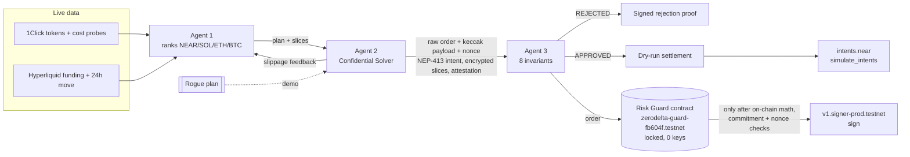

# ZeroDelta

**An autonomous agent swarm that finds, confidentially executes, and risk-guards delta-neutral cross-chain carry trades on NEAR, where an on-chain contract is the only path to the treasury's signing key.**

**▶ Live demo: [zerodelta.vercel.app](https://zerodelta.vercel.app/)**. No wallet or install needed. The green button runs an approved rebalance; the red button injects a rogue 10x trade; the amber button simulates a compromised solver that lies about its order.

ZeroDelta lets a DAO or AI-run treasury earn perp funding carry (spot long + equal perp short, net delta ≈ 0) across NEAR, Solana, Arbitrum, Bitcoin and Hyperliquid without giving any AI agent unrestricted keys. Agents can propose anything. A deterministic guard checks the math off-chain, and a **locked NEAR smart contract recomputes it on-chain** before it will ask NEAR Chain Signatures for a signature.

| Track | How ZeroDelta fits |
|---|---|
| **[01 / DFI] Unstoppable DeFi** | Funding-rate carry on NEAR Intents (`intents.near`, 1Click API). The hedge key belongs to a Chain Signatures path that only the Risk Guard contract can use. |
| **[03 / PRV] Privacy & Private AI** | The solver slices orders and encrypts each slice with `nacl.box`; only ciphertext and SHA-256 commitments are public. The TEE is a software prototype (see [limits](#what-is-real-and-what-is-simulated)). |
| **[04 / BUS] Autonomous Business** | The treasury runs itself: it ranks markets net of costs, sizes the hedge, slices orders and leaves a hash-chained, signed audit trail plus on-chain attestations. |
| **[05 / SWM] AI Swarms** | Three agents with separate jobs. Agent 1 and Agent 2 negotiate slice counts from live slippage feedback before Agent 3 sees the order. |
| **[06 / SEC] AI Security & Defense** | Policy engine enforced in a Rust contract with no access keys: on-chain math from raw legs, keccak256 payload commitment, nonce replay protection, guard-gated MPC. Five real testnet transactions, three of them blocked attacks. |
| **[07 / AGT] Agent Economy** | An agent that holds and spends treasury value only through a contract-enforced policy, with every approval and signature recorded on-chain. |

---

## One-command verification (for automated judges)

```bash
npm install
npm test          # 56 deterministic offline tests (Vitest)
npm run verify    # 53 live end-to-end checks: NEAR RPC, intents.near, 1Click, Hyperliquid, deployed contract, 5 testnet txs
npm run build     # production Next.js build, zero TypeScript errors
npm run dev       # open http://localhost:3000

# optional, needs Rust: the contract's own 18 unit tests
cd contracts/risk-guard && cargo test
```

Requirements: Node.js ≥ 20.9. No API keys, wallets or Docker. Rust is only needed for `cargo test` or rebuilding the contract; the deployed WASM is committed.

The hosted demo is a convenience. `npm run verify` is the complete, reproducible check of every claim in this README. It exits `0` only if every check passes and writes `verify-report.json`. Levels: `PASS`, `WARN` (a live source was unreachable and a labelled fallback was used), `SKIP` (offline mode), `FAIL` (exit 1). Without internet, `ZERODELTA_OFFLINE=1 npm run verify` runs the 19 offline checks and skips the 25 live ones.

Sample output (abridged, real run on 2026-11-09):

```
▸ 7. Deterministic risk policy, contract mirror and adversarial cases (offline)
  ✔ PASS  TS mirror matches the Rust unit-test vectors
  ✔ PASS  Offline replay of the approved order rejected  — NONCE_ALREADY_USED …
  ✔ PASS  Offline compromised solver (spoofed metrics) rejected  — claimed delta 0.00% looks safe; violations: ENVELOPE_INTEGRITY, ORDER_PAYLOAD_BINDING
  ✔ PASS  Offline Agent 1/2 reslice negotiation  — 1 slices 25.81 bps -> 7 slices 9.76 bps
▸ 8. Full live swarm (ranking, negotiation, dry-run settlement, contract cross-check)
  ✔ PASS    Agent 1 ranked all 4 markets by net-of-cost carry  — #1 NEAR 10.95% gross -> 9.855% net | #2 BTC … | #4 SOL -24.685% gross -> -29.35% net (4/4 live cost probes)
  ✔ PASS  Autonomous delta-neutral rebalance ($50,000, AUTO pair, auto slices)  — APPROVED NEAR; net delta 0.00%, leverage 1.33x
  ✔ PASS    MPC request is routed through the Risk Guard contract
  ✔ PASS    Deployed contract recomputes the same order and approves it  — check_order_params: 0 bps / 134 (x100), payload match true
  ✔ PASS    Deployed contract flags PAYLOAD_COMMITMENT_MISMATCH
▸ 9. On-chain NEAR testnet proof (locked Risk Guard v2 + real transactions)
  ✔ PASS  Approved order verified on-chain; contract calls MPC sign  — … contract zerodelta-guard-fb604f.testnet called v1.signer-prod.testnet.sign
  ✔ PASS  Rogue 10x order rejected on-chain (math)  — ZERODELTA_REJECTED: DELTA_NEUTRALITY: 99970 bps > 200 bps; LEVERAGE_CEILING …; no MPC receipt
  ✔ PASS  Spoofed payload rejected on-chain  — ZERODELTA_REJECTED: PAYLOAD_COMMITMENT_MISMATCH …
  ✔ PASS  Replay of the approved order rejected on-chain  — ZERODELTA_REJECTED: NONCE_ALREADY_USED …
  ✔ PASS  Contract is locked; code, policy and MPC target match  — 0 access keys; policy 200/300/25
Summary  53 passed · 0 warnings · 0 skipped · 0 failed
ALL CHECKS PASSED
```

---

## Security architecture: why the solver cannot bypass the Risk Guard

The treasury's hedge key is a NEAR Chain Signatures key. `v1.signer-prod.testnet` derives it from `(predecessor_account_id, path)`. In ZeroDelta the predecessor is the **Risk Guard contract account** [`zerodelta-guard-fb604f.testnet`](https://testnet.nearblocks.io/address/zerodelta-guard-fb604f.testnet), so a signature for that key can only come from the contract's own code. Source: [`contracts/risk-guard/src/lib.rs`](contracts/risk-guard/src/lib.rs).

1. **On-chain math from raw legs, no trusted metrics.** The solver submits raw order legs in integer USD cents (`spot_long`, `perp_short`, `perp_long`, `collateral`, `treasury`). The contract computes the risk itself:
   - `net_delta_bps = ceil(|spot + perp_long − perp_short| × 10 000 / treasury)` must be ≤ 200
   - `leverage_x100 = ceil((spot + perp_short + perp_long) × 100 / collateral)` must be ≤ 300
   - `quoted_slippage_bps` must be ≤ 25; collateral may not exceed treasury, so leverage can't be diluted

   Rounding is always up, so the on-chain check is never looser than the off-chain one.
2. **Payload commitment.** The 32-byte payload that MPC will sign must equal `keccak256("zerodelta-hedge-v1|<contract>|<asset>|<treasury>|<spot>|<perp_short>|<perp_long>|<collateral>|<slippage>|<nonce>")`, computed inside the contract. Safe-looking numbers with the payload of a different order fail with `PAYLOAD_COMMITMENT_MISMATCH`. The TypeScript mirror ([`orderCommitment.ts`](src/lib/near/orderCommitment.ts)) is checked against the contract's `compute_payload` view by `npm run verify`.
3. **Guard-gated MPC.** Only after every check passes does `record_rebalance` itself call `v1.signer-prod.testnet.sign` (a cross-contract `Promise` with a `.then(on_mpc_signed)` callback that stores the signature next to the attestation). The deploy transaction deleted the contract account's only full-access key, so nobody can sign as that account directly, change the policy, or redeploy the code. `npm run verify` checks the account has **0 access keys** and finds the receipt `zerodelta-guard-fb604f.testnet → v1.signer-prod.testnet.sign` inside the approved transaction.
4. **Replay protection.** Every order has a nonce that must be strictly greater than the contract's `last_nonce`. Re-sending an approved order fails with `NONCE_ALREADY_USED`, and so does any older nonce.
5. **Only the registered solver** may call `record_rebalance` (`UNAUTHORIZED_SOLVER` otherwise), and any deposit is only accepted with an MPC request.

Any violation makes the contract panic with `ZERODELTA_REJECTED: …`: the transaction fails, nothing is stored, and no MPC receipt exists.

**Adversarial coverage**

| Attack | Off-chain (Agent 3) | On-chain (contract) | Where it's tested |
|---|---|---|---|
| Rogue 10x directional long | `DELTA_NEUTRALITY`, `LEVERAGE_CEILING` | Same, from raw legs; [failed tx](https://testnet.nearblocks.io/txns/H46fyRHiFoVrY6L3k9758ceRB6bhfT9v4onqZKkbonQo) | Vitest, Rust, verify §7 §8 §9 |
| Compromised solver reports hedged legs, hides a 10x order in slices + payload | `ENVELOPE_INTEGRITY`, `ORDER_PAYLOAD_BINDING` | `PAYLOAD_COMMITMENT_MISMATCH`; [failed tx](https://testnet.nearblocks.io/txns/4PpxYCPEqwtLnuGR6i1Te2wWvs3Ynb94KqqqphEvbSHq) | Vitest, Rust, verify §7 §8 §9 |
| Payload swapped after approval | `ORDER_PAYLOAD_BINDING`, `TEE_ATTESTATION`, `REPLAY_AND_MPC_GATE` | `PAYLOAD_COMMITMENT_MISMATCH` | Vitest, Rust |
| Replay of an approved order | `REPLAY_AND_MPC_GATE` | `NONCE_ALREADY_USED`; [failed tx](https://testnet.nearblocks.io/txns/3rQrPFjByJmK676YJyX7v785unoSr6FanWTdrKfXqSff) | Vitest, Rust, verify §7 §9 |
| Caller isn't the solver (incl. the guard account itself) | n/a | `UNAUTHORIZED_SOLVER` | Rust |
| Inflated collateral to dilute leverage | n/a | `INVALID_ORDER: collateral exceeds treasury` | Rust |
| Forged NEP-413 signature / tampered slice / stale or forged attestation | `NEP413_SIGNATURE`, `ENVELOPE_INTEGRITY`, `TEE_ATTESTATION` | n/a | Vitest, verify §1 §4 |

**Honest limits of the on-chain guard.** The contract cannot see off-chain prices, so the treasury size and the quoted slippage are reported by the solver. They are bound into the signed payload and stored on-chain, so a lie is permanent and attributable, but the contract cannot detect it. In production the treasury figure would be read from the vault's own balances. The TEE is a software prototype boundary: its checks are real cryptography, but there is no hardware root of trust.

---

## On-chain proof (NEAR testnet)

Every value below is in [`testnet-proof.json`](testnet-proof.json) and is re-checked by `npm run verify` §9.

| What | On NEAR testnet |
|---|---|
| Risk Guard v2 contract (locked, 0 access keys) | [`zerodelta-guard-fb604f.testnet`](https://testnet.nearblocks.io/address/zerodelta-guard-fb604f.testnet) |
| Solver agent account (only allowed caller) | [`zerodelta-solver-fb604f.testnet`](https://testnet.nearblocks.io/address/zerodelta-solver-fb604f.testnet) |
| Immutable policy | `max_delta_bps: 200`, `max_leverage_x100: 300`, `max_slippage_bps: 25` |
| Contract code hash | `6VqcNeQLfWWN7XyFHbvhZJoDoZLNQMEsgRpapn1jJEqk` = sha256 of the committed [`zerodelta_risk_guard.wasm`](contracts/risk-guard/res/zerodelta_risk_guard.wasm) |
| Hedge key (derived for the contract, path `zerodelta/hedge/arbitrum`) | `0x9d5A25917b23C1CF60fD5c7695621FD3Dca754dD` |

| # | Transaction | Result | Nearblocks |
|---|---|---|---|
| 1 | Guard account deploys the contract, calls `new` (policy, solver, MPC target) and **deletes its only access key**, all in one transaction | ✅ Success | [12skMoFQ…vXM5Lx](https://testnet.nearblocks.io/txns/12skMoFQC6sNfB6YNqmpEiK8DCQUWYFPcDLNoAvXM5Lx) |
| 2 | Solver sends the approved raw order (NEAR, spot $33,273.35 / short $33,273.35 on a $50,000 treasury). The contract computes 0 bps / 1.34x, verifies keccak256(order) and the nonce, stores attestation #0, then **itself** calls `v1.signer-prod.testnet.sign` and stores the returned signature | ✅ Success, receipt `zerodelta-guard-fb604f.testnet → v1.signer-prod.testnet.sign` | [DZaDDUGQ…n37JfV](https://testnet.nearblocks.io/txns/DZaDDUGQQLBkdZHiZxn95NtrmeUiGrd3a7af4hn37JfV) |
| 3 | Solver sends the rogue 10x order (spot $49,846 + perp long $450,000) with an honest payload and asks for a signature. Net delta **99,970 bps (at time of tx)**, leverage 10.00x | ❌ Fails on purpose: `DELTA_NEUTRALITY`, `LEVERAGE_CEILING`; no MPC receipt | [H46fyRHi…kbonQo](https://testnet.nearblocks.io/txns/H46fyRHiFoVrY6L3k9758ceRB6bhfT9v4onqZKkbonQo) |
| 4 | Solver sends the approved, delta-neutral numbers with a fresh nonce but the payload of a 10x long | ❌ Fails on purpose: `PAYLOAD_COMMITMENT_MISMATCH`; no MPC receipt | [4PpxYCPE…EvbSHq](https://testnet.nearblocks.io/txns/4PpxYCPEqwtLnuGR6i1Te2wWvs3Ynb94KqqqphEvbSHq) |
| 5 | Solver resends transaction 2 byte-for-byte to get a second signature | ❌ Fails on purpose: `NONCE_ALREADY_USED`; no MPC receipt | [3rQrPFjB…fXqSff](https://testnet.nearblocks.io/txns/3rQrPFjByJmK676YJyX7v785unoSr6FanWTdrKfXqSff) |

The rogue figures differ slightly between the recorded transaction and a fresh dry run (for example 99,970 vs 99,996 bps), because each run quotes live prices.

How `npm run verify` checks this:
- Fetches each transaction with `EXPERIMENTAL_tx_status` (`wait_until: FINAL`), archival RPC first because regular nodes such as `rpc.testnet.near.org` drop transactions after about 2–3 days; falls back to `rpc.testnet.near.org`. It confirms signer, receiver and method; that 1 and 2 succeeded and 3–5 failed with the expected error; that **no** rejected transaction produced an MPC receipt; and that transaction 2 contains the receipt in which the contract calls `sign`, with a return value equal to the recorded signature.
- Reads the live contract: 0 access keys, code hash matches the committed WASM, policy 200 / 300 / 25, MPC target, attestation #0 with status `Signed` and the same signature.
- Calls `check_order_params` on the recorded orders: the approved order now fails only with `NONCE_ALREADY_USED`, the rogue order on the math, the swapped payload on the commitment. Calls `compute_payload` and compares it with the TypeScript keccak256.
- Recovers the public key from the MPC signature offline and checks it equals `derived_public_key(path, zerodelta-guard-fb604f.testnet)`.

Every dashboard run also sends its raw order to the deployed contract's free `check_order_params` view, shows the contract-computed delta and leverage, and reports whether the contract agrees with Agent 3. The website holds no signing keys, so dashboard runs never create transactions.

**Previous deployment.** v1 ([`zerodelta-guard-05eb36.testnet`](https://testnet.nearblocks.io/address/zerodelta-guard-05eb36.testnet)) trusted solver-reported metrics, and its guard account called the MPC signer directly with a full-access key. An audit flagged both; v2 fixes them and replaces v1. The v1 transactions are listed under `previousDeployment` in `testnet-proof.json` for history only.

Rebuilding the contract (optional, Rust 1.81 + `wasm32-unknown-unknown`): `npm run contract:build`. Re-running the setup with fresh accounts: move `.testnet-keys.json` aside and run `npm run testnet:setup`. Private keys are written only to `.testnet-keys*.json`, which is git-ignored.

---

## What is real and what is simulated

| Component | Status | Evidence |
|---|---|---|
| NEAR RPC (blocks, gas, accounts) on testnet + mainnet | **Live** | `rpcClient.ts`, verify §2 |
| NEP-413 serialisation + Ed25519 signing | **Real cryptography**, byte-identical to near-api-js `KeyPairSigner.signNep413Message` | Vitest, verify §1 |
| Signed intents checked by the real `intents.near` contract | **Live mainnet dry-run** via `simulate_intents` | verify §4 |
| 1Click tokens, cost probes and slice quotes | **Live** (`dry: true`, no deposit address, no JWT) | verify §5, §8 |
| Funding rates and 24h moves | **Live** Hyperliquid public `info` endpoint | verify §6 |
| Multi-asset ranking and Agent 1/2 negotiation | **Live** on every run | verify §8 |
| Risk Guard v2 contract | **Deployed on testnet, locked** at [`zerodelta-guard-fb604f.testnet`](https://testnet.nearblocks.io/address/zerodelta-guard-fb604f.testnet) | [deploy tx](https://testnet.nearblocks.io/txns/12skMoFQC6sNfB6YNqmpEiK8DCQUWYFPcDLNoAvXM5Lx), verify §9 |
| Contract-issued Chain Signatures `sign()` | **Executed once on testnet** by the contract; signature verifies against the contract's derived key | [sign tx](https://testnet.nearblocks.io/txns/DZaDDUGQQLBkdZHiZxn95NtrmeUiGrd3a7af4hn37JfV), verify §9 |
| Rogue / spoofed-payload / replay attacks blocked on-chain | **Real failed testnet transactions** | [rogue](https://testnet.nearblocks.io/txns/H46fyRHiFoVrY6L3k9758ceRB6bhfT9v4onqZKkbonQo), [spoof](https://testnet.nearblocks.io/txns/4PpxYCPEqwtLnuGR6i1Te2wWvs3Ynb94KqqqphEvbSHq), [replay](https://testnet.nearblocks.io/txns/3rQrPFjByJmK676YJyX7v785unoSr6FanWTdrKfXqSff) |
| Contract's verdict on each dashboard run | **Live** `check_order_params` view | verify §8 |
| Order-slice encryption | **Real** X25519-XSalsa20-Poly1305 (`tweetnacl` box) | `solverAgent.ts`, `guardianAgent.ts` |
| TEE enclave + attestation | **Software-simulated prototype boundary.** Real SHA-256 measurement, Ed25519 report signature bound to the envelope, intent, plan and hedge payload, freshness checks; no hardware root of trust. In production this would be an Intel TDX quote from NEAR AI Cloud / Phala. | `attestation.ts` |
| Fills / funds movement | **None.** Swarm runs use a fresh, unfunded implicit account; dashboard runs prepare `record_rebalance` but don't broadcast it. Testnet NEAR has no real value. | — |

**Yield, honestly.** Funding and 1Click spreads change hourly, so the scanner shows the live figures instead of promising one. In the 2026-11-09 runs, gross funding was about 2–11% APR for NEAR, ETH and BTC and **negative** for SOL; 1Click round-trip costs ranged from 9 to 77 bps for the same asset across runs. The treasury earns the net carry on its spot fraction (about two-thirds at a 2x hedge), so roughly 0–7% APR, and sometimes the right answer is to stay in USDC, which the scanner says when no market has positive net carry.

---

## The agents

### Agent 1 — Autonomous Opportunity Scanner ([`scannerAgent.ts`](src/lib/agents/scannerAgent.ts))
Every run it evaluates **all** candidates (NEAR, SOL, ETH, BTC) in parallel:

| Field | Formula / source |
|---|---|
| `grossCarryAprPct` | live Hyperliquid hourly funding × 24 × 365 |
| `entryCostBps` | live 1Click $100 USDC → spot dry quote: (in − out) / in, i.e. spread + fees |
| `estimatedRoundTripCostBps` | 2 × entry cost + 2 × 4.5 bps perp taker fee |
| `netCarryAprPct` | gross − round trip amortised over a 30-day holding horizon |
| `breakevenDays` | round-trip cost / daily funding |
| `hedgeLeverage` | 1x–2x, so the short's liquidation sits ≥ 10 daily moves away (live 24h move) |
| `recommendedSlices` | spot notional / max slice, where max slice keeps modelled impact ≤ 10 bps (fitted √-impact curve from a live $10k probe quote) and ≤ 0.05% of the perp's 24h volume |

It ranks the matrix (eligible markets first, then by net carry), picks #1 in **Auto** mode or records a manual override, and builds the plan: `spot = treasury × L/(1+L)`, the rest as margin, and a perp short equal to the spot fill.

### Agent 1 ↔ Agent 2 negotiation ([`orchestrator.ts`](src/lib/swarm/orchestrator.ts))
Agent 2 quotes the slices live. If the slice slippage is above Agent 1's 10 bps target, the agents negotiate: `SOLVER_SLIPPAGE_FEEDBACK` → `SCANNER_RESLICE_ADJUSTMENT` with `slices × (observed / target)²` (impact grows with √size), up to 3 reslices. Each round is recorded in the hash-chained audit trail and shown in the dashboard. A live NEAR run, for example, went 1 → 5 → 11 → 22 slices and 21 → 4.7 bps before reaching Agent 3.

### Agent 2 — Confidential Solver & NEP-413 Intent Crafter ([`solverAgent.ts`](src/lib/agents/solverAgent.ts))
Quotes every leg live (local model if 1Click is down), sizes the short to the quoted spot fill, encrypts the TWAP slices to Agent 3's X25519 key, signs a NEP-413 `token_diff` intent for `intents.near`, derives the raw order in cents with a fresh nonce, computes the keccak256 hedge payload, and issues an attestation bound to the envelope, intent, plan and payload. In `spoofed_metrics` mode it behaves like a hijacked solver.

### Agent 3 — Deterministic Risk Guard ([`guardianAgent.ts`](src/lib/agents/guardianAgent.ts))
Plain code, no LLM. Eight invariants:

| # | Invariant | Rule |
|---|---|---|
| 1 | Delta neutrality | `|Σ leg delta| / treasury ≤ 2%` |
| 2 | Leverage ceiling | `Σ |spot + perp notional| / collateral ≤ 3.0x` |
| 3 | Slippage ceiling | max slice slippage ≤ 25 bps |
| 4 | TEE attestation | signature, measurement allowlist, pinned key, report data bound to envelope + intent + plan + payload, age ≤ 5 min |
| 5 | NEP-413 signature | tweetnacl + near-api-js verify; recipient, signer, deadline, `token_diff` = quoted spend |
| 6 | Envelope integrity | every slice decrypts, matches its commitment, and slices sum to the quoted order |
| 7 | Order-to-payload binding | raw legs re-derived from the plan == the solver's order, and keccak256(order) == the payload |
| 8 | Anti-replay + guard-gated MPC | nonce > on-chain `last_nonce` and every nonce this guard approved; the sign request goes through the contract |

On approval it signs the decision and prepares the `record_rebalance` call (with `request_mpc_sign: true`) for the contract, never a direct MPC call.

---

## Architecture



---

## API ([`src/app/api/swarm/route.ts`](src/app/api/swarm/route.ts))

- `GET /api/swarm` — live telemetry (testnet/mainnet blocks, gas, `intents.near` and `v1.signer-prod.testnet` state, MPC version, 1Click token count) plus `onchain`: the contract's live state and the verified status of every proof transaction.
- `POST /api/swarm` — body `{ "mode": "rebalance" | "rogue" | "spoofed_metrics", "treasuryUsd": 10000–1000000, "pair": "AUTO" | "NEAR" | "SOL" | "ETH" | "BTC", "sliceCount": "auto" | 1–24 }`. Input is validated and clamped. Returns the full run: opportunity matrix, negotiation rounds, signatures, hashes, attestation, decision, the contract's own verdict and the audit trail. Private keys never leave the server process (a test asserts this). A live run takes about 4–8 seconds.

```bash
# live telemetry + on-chain proof status
curl -s https://zerodelta.vercel.app/api/swarm | jq '{block: .testnet.latestBlockHeight, contract: .onchain.contractId, locked: .onchain.guard.locked, allVerified: .onchain.allVerified}'

# autonomous rebalance: which market won, how the agents negotiated, what the contract computed
curl -s -X POST https://zerodelta.vercel.app/api/swarm -H 'content-type: application/json' \
  -d '{"mode":"rebalance","treasuryUsd":50000,"pair":"AUTO","sliceCount":"auto"}' \
  | jq '{decision: .guardian.decision, pair: .resolved.pair, matrix: [.scanner.opportunityMatrix[] | {asset, netCarryAprPct}], negotiation: [.negotiation[] | {sliceCount, observedSlippageBps, action}], contract: .onchainCheck | {approved, netDeltaBps, leverageX100, payloadMatches}}'

# rogue 10x trade
curl -s -X POST https://zerodelta.vercel.app/api/swarm -H 'content-type: application/json' \
  -d '{"mode":"rogue"}' | jq '{decision: .guardian.decision, violations: .guardian.violations, contract: .onchainCheck.violations}'

# compromised solver that hides a 10x order behind safe-looking metrics
curl -s -X POST https://zerodelta.vercel.app/api/swarm -H 'content-type: application/json' \
  -d '{"mode":"spoofed_metrics"}' | jq '{decision: .guardian.decision, violations: .guardian.violations, contract: .onchainCheck.violations}'
```

### Dashboard ([`src/app/page.tsx`](src/app/page.tsx))
Live telemetry bar with an on-chain strip (contract, policy, lock status, Nearblocks links for all five transactions); portfolio controls (treasury, Auto or manual pair, auto or manual slices); three one-click demo buttons; the opportunity ranking table; negotiation log; order commitment and nonce; all eight invariants with the contract's verdict; the cross-chain allocation; and a proof inspector with the NEP-413 intent, the guard-gated MPC request, the attestation, the on-chain proof and the audit trail.

---

## Project layout

```
src/
  app/
    api/swarm/route.ts        GET telemetry + on-chain status, POST run swarm
    page.tsx                  dashboard
  components/ui.tsx           small UI primitives
  lib/
    near/rpcClient.ts         NEAR RPC, MPC, intents.near, 1Click (timeouts + failover + fallbacks)
    near/nep413.ts            NEP-413 borsh, nonce, sign, verify
    near/orderCommitment.ts   TS mirror of the contract's order math and keccak256 commitment
    near/riskGuardContract.ts contract reads, check_order_params, tx + receipt verification, MPC signature check
    near/deployment.ts        deployed contract / solver account ids
    market/fundingFeed.ts     Hyperliquid funding feed
    crypto/attestation.ts     simulated TEE measurement + attestation
    crypto/encoding.ts        hashing, canonical JSON, base58/64
    agents/scannerAgent.ts    Agent 1: ranking, sizing, slice recommendation, reslice
    agents/solverAgent.ts     Agent 2: quotes, slices, intent, order commitment
    agents/guardianAgent.ts   Agent 3: 8 invariants, guard-gated MPC request
    swarm/orchestrator.ts     pipeline, negotiation loop, audit chain
    swarm/types.ts            shared types, pairs, input validation
contracts/risk-guard/         Rust Risk Guard v2 (src/lib.rs, 18 unit tests) + deployed WASM (res/)
scripts/verify-hackathon.ts   judge verification harness
scripts/testnet-setup.ts      one-time testnet accounts, deploy + lock, proof transactions
testnet-proof.json            public account ids, code hash, orders, payloads, signature, tx hashes
tests/swarm.test.ts           Vitest suite
```

## Limitations and next steps
- Replace the simulated enclave with a NEAR AI Cloud / Phala TDX quote and verify it against Intel's collateral.
- Read the treasury size from the vault's balances inside the contract instead of trusting the solver's figure.
- Submit the MPC-signed hedge order to Hyperliquid and execute intents from a funded account instead of `simulate_intents`.
- Quote every slice separately rather than scaling one live slice quote.

## License
MIT
