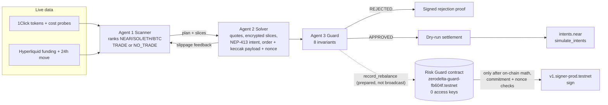

# ZeroDelta

**ZeroDelta is an autonomous cross-chain carry-strategy prototype. Its keyless NEAR Risk Guard contract recomputes the risk of every order and is the only account that can get NEAR Chain Signatures to sign for the treasury's hedge key. In v3 the contract builds the executable Hyperliquid order itself and has the MPC network sign that order's EIP-712 digest.**

▶ **Live demo:** [zerodelta.vercel.app](https://zerodelta.vercel.app/) (no wallet needed) · **Judge guide:** [docs/JUDGE_GUIDE.md](docs/JUDGE_GUIDE.md) · **Primary track:** 06 / SEC AI Security & Defense

## v3 proof: Hyperliquid testnet recovered the contract's MPC-derived hedge address from the signature; flipped `v` and flipped `s` recover different addresses

| Step | What happened | Evidence |
|---|---|---|
| 1. Approved legs | The solver sent raw SOL legs (spot long $33,275.81, perp short $33,275.81 on a $50,000 treasury). The contract recomputed delta, leverage and slippage against the immutable 200 / 300 / 25 policy. | [tx `2SAhjj5X…`](https://testnet.nearblocks.io/txns/2SAhjj5Xju19NA3t9KsjTGAoQp5RWyhTbwEpqC6wUdkF) |
| 2. Contract-built action | The contract built the only order it will sign: one IOC **sell** of 361.84 SOL at 91.961 on Hyperliquid **testnet** market 0, not reduce-only. Size = approved perp short ÷ limit, in whole lots. The limit is within 100 bps of the reference 92.424. | attestation #0 on [`zerodelta-guard-v3-a9c75f.testnet`](https://testnet.nearblocks.io/address/zerodelta-guard-v3-a9c75f.testnet) |
| 3. Digest | The contract msgpack-encoded that action and computed `connectionId` and the EIP-712 phantom-agent digest `20765c12…49258ee02f` on-chain. It never accepts a digest from the solver. | `npm run verify` §10: *Recorded v3 digest == TS mirror rebuilt from the recorded request* |
| 4. MPC sign | Only then did the contract itself call `v1.signer-prod.testnet.sign` (predecessor = contract, path `zerodelta/hedge/hyperliquid`) and store `{r, s, v = recovery_id + 27}`. | receipt `zerodelta-guard-v3-a9c75f.testnet → v1.signer-prod.testnet.sign` in the same tx |
| 5. Exchange | `POST https://api.hyperliquid-testnet.xyz/exchange` with `{action, nonce, signature}`. Hyperliquid recovered **`0xef639b571185dc6ee0e4680de4e8dd81e7e02c66`**, the contract's MPC-derived hedge address. The same signature with `v` flipped recovered `0xd9cf…3608`, and with one bit of `s` flipped `0x3f5d…9860`. | [`hl-acceptance.json`](hl-acceptance.json), `npm run hl:acceptance` |

The binding chain is **approved legs → contract-built action → digest → MPC sign → exchange recovers the hedge address**. The proof that links them is verify §10's check that the recorded digest equals a fresh TypeScript rebuild from the recorded request, together with the live check that the contract's own view rebuilds the same digest today. Hyperliquid answered "User or API Wallet 0xef63…2c66 does not exist" because that address has no Hyperliquid account. No order was placed and nothing was filled. The *address* in that answer is the proof; the message alone is not (a broken signature gets the same message with a different address).

Also on-chain, all with no MPC receipt: [limit 3% from the reference → `PRICE_OUT_OF_BAND`](https://testnet.nearblocks.io/txns/EznaA4oyAhMxADoHTEToFEurf8JZKg3vs65tGYNfKbEq) · [byte-identical replay → `NONCE_ALREADY_USED`](https://testnet.nearblocks.io/txns/CRCZghG2vHL3xrSp27XuWM41SmtR6pNsKjE8FoYLLyjQ) · [solver calls the private callback → rejected](https://testnet.nearblocks.io/txns/8pL5kKgXZkry3WVXeA2ai4Ys6nzj5BgQDUbt5CBieoSh) · [deploy, init and delete the only key in one tx](https://testnet.nearblocks.io/txns/3ZazKuBgvi3mQaWout48RvujJ2cuA5FdhasvjqxUm5Vh).

**v2 proof on NEAR testnet**, kept as history (contract [`zerodelta-guard-fb604f.testnet`](https://testnet.nearblocks.io/address/zerodelta-guard-fb604f.testnet), 0 access keys; it signs a ZeroDelta order commitment, not an exchange order):
[contract calls the MPC signer after its checks](https://testnet.nearblocks.io/txns/DZaDDUGQQLBkdZHiZxn95NtrmeUiGrd3a7af4hn37JfV) ·
[spoofed payload rejected](https://testnet.nearblocks.io/txns/4PpxYCPEqwtLnuGR6i1Te2wWvs3Ynb94KqqqphEvbSHq) ·
[rogue 10x rejected](https://testnet.nearblocks.io/txns/H46fyRHiFoVrY6L3k9758ceRB6bhfT9v4onqZKkbonQo) ·
[replay rejected](https://testnet.nearblocks.io/txns/3rQrPFjByJmK676YJyX7v785unoSr6FanWTdrKfXqSff) ·
[deploy + lock](https://testnet.nearblocks.io/txns/12skMoFQC6sNfB6YNqmpEiK8DCQUWYFPcDLNoAvXM5Lx)

| Question | Answer |
|---|---|
| What is it? | Three cooperating, deterministic agents (scanner, confidential solver, risk guard) that find, size and check delta-neutral funding-carry trades across NEAR, Solana, Arbitrum, Bitcoin and Hyperliquid, plus a locked NEAR contract that is the only path to the treasury's signing key. |
| What problem? | An AI agent with a treasury key can lose everything on one hallucinated or hijacked trade. Spending limits in the agent's own code don't help if the agent is the thing that's compromised. |
| Why NEAR? | Chain Signatures derives a key per *calling account*, and a NEAR contract can be that caller and can delete all its access keys. So a smart contract, not a person or agent, holds signing authority, and its rules can't be changed. |
| What is implemented? | Two locked contracts on testnet (v2: 33 Rust tests; v3: 44 Rust tests, incl. the official Hyperliquid SDK vectors and byte-for-byte parity with the TypeScript signer), real NEP-413 intents checked by `intents.near`, live 1Click and Hyperliquid data, the agent pipeline, and a harness that re-verifies everything (75 checks). |
| What does the demo prove? | v3: a locked contract built a Hyperliquid testnet order from risk-checked legs and got NEAR's MPC network to sign it, and Hyperliquid recovered the contract's hedge address from that signature. v2: a lying solver, a rogue 10x trade and a replay all failed as real testnet transactions without producing an MPC signature. |
| What is not implemented? | No funds move, no order fills, no mainnet. The TEE is simulated. The v3 reference price is a trusted solver input. See [Limitations](#limitations). |
| How do I reproduce it? | `npm ci && npm test && npm run verify && npm run build`, plus `cargo test` in `contracts/risk-guard` and `contracts/risk-guard-v3`. See [Quick start](#quick-start). |

---

## Flagship security demonstration

Click **Simulate Compromised Solver (Spoofed Metrics)** on the [demo](https://zerodelta.vercel.app/). The solver reports a hedged order (≈0% delta, ~1.3x) but its MPC payload commits to 100% spot + a 9x perp long (≈1000% delta, 10x), and its encrypted slices spend the whole treasury. The page shows side by side:

| Solver claim | Actual payload | Risk Guard decision | Contract evidence |
|---|---|---|---|
| net delta 0.00%, leverage ≈1.3x | net delta ≈1000%, leverage 10x | **REJECTED**: `ORDER_PAYLOAD_BINDING` (`PAYLOAD_COMMITMENT_MISMATCH`), `ENVELOPE_INTEGRITY` | Live `check_order_params` on the deployed contract: `PAYLOAD_COMMITMENT_MISMATCH`. Historical: the same attack sent on-chain [failed](https://testnet.nearblocks.io/txns/4PpxYCPEqwtLnuGR6i1Te2wWvs3Ynb94KqqqphEvbSHq) with no MPC receipt. |

Delta and leverage pass on the claim; the fingerprint check is what refuses to trust it.

### Why this is not just another AI trading bot
Most agent "guardrails" are checks in the same process that holds the key. Here the agents hold no key. The only code that can request a signature for the hedge key is a public, hash-verified, keyless contract that recomputes the risk itself, so a compromised agent or server can at worst submit orders the policy allows (see the trusted inputs in [SECURITY_MODEL.md](docs/SECURITY_MODEL.md)).

---

## NEAR-specific architecture



- **Chain Signatures:** `v1.signer-prod.testnet` derives the hedge key from `(predecessor, path)`. The predecessor is the contract, so v2's key ([`0x9d5A…754dD`](https://testnet.nearblocks.io/txns/DZaDDUGQQLBkdZHiZxn95NtrmeUiGrd3a7af4hn37JfV)) is usable only through `record_rebalance`, and v3's key `0xef63…2c66` (path `zerodelta/hedge/hyperliquid`) only through `sign_executable_hedge`.
- **v3:** the same flow, except the solver calls `sign_executable_hedge` on [`zerodelta-guard-v3-a9c75f.testnet`](https://testnet.nearblocks.io/address/zerodelta-guard-v3-a9c75f.testnet), which builds the Hyperliquid IOC sell and its EIP-712 digest on-chain and has the MPC sign that digest ([contract README](contracts/risk-guard-v3/README.md)).
- **Keyless account:** the deploy transaction deleted the contract account's only full-access key. Policy, solver and code are immutable.
- **NEAR Intents:** spot legs are priced with live 1Click dry quotes and the swarm's NEP-413 `token_diff` intent is executed by the real `intents.near` contract via `simulate_intents` (signature accepted, then stops at the balance check for the unfunded demo account).

---

## Real deployed proof (NEAR testnet)

All values are in [`testnet-proof.json`](testnet-proof.json) and re-checked by `npm run verify` §9 against an archival RPC.

| What | Value |
|---|---|
| Risk Guard v2 contract (locked, 0 access keys) | [`zerodelta-guard-fb604f.testnet`](https://testnet.nearblocks.io/address/zerodelta-guard-fb604f.testnet) |
| Solver (only allowed caller) | [`zerodelta-solver-fb604f.testnet`](https://testnet.nearblocks.io/address/zerodelta-solver-fb604f.testnet) |
| Immutable policy | `max_delta_bps 200`, `max_leverage_x100 300`, `max_slippage_bps 25` |
| Code hash | `6VqcNeQLfWWN7XyFHbvhZJoDoZLNQMEsgRpapn1jJEqk` = sha256 of the committed [`zerodelta_risk_guard.wasm`](contracts/risk-guard/res/zerodelta_risk_guard.wasm) |
| Hedge key (derived for the contract, path `zerodelta/hedge/arbitrum`) | `0x9d5A25917b23C1CF60fD5c7695621FD3Dca754dD` |

| # | Transaction | Result | Nearblocks |
|---|---|---|---|
| 1 | Deploy, `new` (policy, solver, MPC target), **delete the only access key**, in one transaction | ✅ Success | [12skMoFQ…vXM5Lx](https://testnet.nearblocks.io/txns/12skMoFQC6sNfB6YNqmpEiK8DCQUWYFPcDLNoAvXM5Lx) |
| 2 | Solver sends the approved raw order (NEAR, spot $33,273.35 / short $33,273.35 on $50,000). Contract computes 0 bps / 1.34x, checks keccak256(order) and the nonce, stores attestation #0, then **itself** calls `v1.signer-prod.testnet.sign` and stores the signature | ✅ Success; receipt `zerodelta-guard-fb604f.testnet → v1.signer-prod.testnet.sign` | [DZaDDUGQ…n37JfV](https://testnet.nearblocks.io/txns/DZaDDUGQQLBkdZHiZxn95NtrmeUiGrd3a7af4hn37JfV) |
| 3 | Rogue 10x order (spot $49,846 + perp long $450,000), honest payload. Net delta **99,970 bps (at time of tx)**, 10.00x | ❌ Fails on purpose: `DELTA_NEUTRALITY`, `LEVERAGE_CEILING`; no MPC receipt | [H46fyRHi…kbonQo](https://testnet.nearblocks.io/txns/H46fyRHiFoVrY6L3k9758ceRB6bhfT9v4onqZKkbonQo) |
| 4 | Approved, delta-neutral numbers with a fresh nonce but the payload of a 10x long | ❌ Fails on purpose: `PAYLOAD_COMMITMENT_MISMATCH`; no MPC receipt | [4PpxYCPE…EvbSHq](https://testnet.nearblocks.io/txns/4PpxYCPEqwtLnuGR6i1Te2wWvs3Ynb94KqqqphEvbSHq) |
| 5 | Byte-identical replay of tx 2 | ❌ Fails on purpose: `NONCE_ALREADY_USED`; no MPC receipt | [3rQrPFjB…fXqSff](https://testnet.nearblocks.io/txns/3rQrPFjByJmK676YJyX7v785unoSr6FanWTdrKfXqSff) |

Rogue figures in fresh dry runs differ slightly from tx 3 (e.g. 99,996 vs 99,970 bps) because quotes are live. The superseded v1 contract (`zerodelta-guard-05eb36.testnet`) trusted solver metrics and let a keyed account call the signer directly; its transactions are kept under `previousDeployment` for history only.

---

## Quick start

```bash
git clone https://github.com/g4stein/zerodelta.git && cd zerodelta
npm ci                 # Node.js >= 20.9, no API keys
npm run dev            # http://localhost:3000
```

On the page: **do** look at the v3 panel under the telemetry bar **→ see** the five-step chain, with the digest and the signature recovered again in your browser and the v3 contract's lock state read live. **Do** click the green button **→ see** the market ranking, the Agent 1/2 negotiation, 8 passing checks and the contract's verdict. **Do** click the amber button **→ see** the claim-vs-payload panel and `PAYLOAD_COMMITMENT_MISMATCH`. **Do** open the *On-chain proof (testnet)* tab **→ see** the five v2 transactions re-verified live.

Re-run the exchange check yourself (testnet, no NEAR transaction, no funds): `npm run hl:acceptance` **→ see** `PASS` for the real signature and different addresses for the two corrupted copies.

## Reproducible tests

Results of the latest full run. [`verify-report.json`](verify-report.json) is that run's machine-readable output: its `source.commit` is the commit the run started from, with `dirty: true` and a hash of the uncommitted diff, because a report can't name the commit that contains it. For a report bound to one exact commit, use the CI artifact `verify-report-offline-<sha>`.

| Command | Result | Network |
|---|---|---|
| `npm run typecheck` | clean | none |
| `npm test` | **113 tests**, 5 files: [`swarm.test.ts`](tests/swarm.test.ts), [`adversarial.test.ts`](tests/adversarial.test.ts), [`hyperliquid.test.ts`](tests/hyperliquid.test.ts), [`hlParity.test.ts`](tests/hlParity.test.ts), [`proofFile.test.ts`](tests/proofFile.test.ts) | none (fetch mocked where used) |
| `cd contracts/risk-guard && cargo test` | **33 tests** (v2): 18 unit tests in `src/lib.rs` + 15 in [`tests/adversarial.rs`](contracts/risk-guard/tests/adversarial.rs) | none (Rust 1.81) |
| `cd contracts/risk-guard-v3 && cargo test` | **44 tests** (v3): 6 unit, 5 official Hyperliquid SDK vectors, 5 TS parity (incl. 110 contract-level cases), 28 [adversarial](contracts/risk-guard-v3/tests/adversarial.rs) | none (Rust 1.81) |
| `npm run verify:offline` | **29 pass, 36 skipped** (live-only) | none |
| `npm run verify` | **75 checks**, read-only (§10 = v3) | public NEAR RPC, 1Click, Hyperliquid |
| `npm run hl:acceptance` | `PASS`: the exchange recovers the hedge address; both corrupted copies recover other addresses | Hyperliquid **testnet** `/exchange` (POST, no funds) |
| `npm run build` | clean | none |

What each layer covers and how to read the report: [docs/VERIFICATION.md](docs/VERIFICATION.md). CI ([`.github/workflows/verify.yml`](.github/workflows/verify.yml)) runs typecheck, tests, build, offline verification and the Rust tests on every push; live verification is a separate manual job because public RPC availability is outside this repo's control.

## Attack demonstrations

| Attack | Off-chain (Agent 3) | On-chain (contract) | Tested in |
|---|---|---|---|
| Rogue 10x directional long | `DELTA_NEUTRALITY`, `LEVERAGE_CEILING` | same, from raw legs; [failed tx](https://testnet.nearblocks.io/txns/H46fyRHiFoVrY6L3k9758ceRB6bhfT9v4onqZKkbonQo) | Vitest, Rust, verify |
| Compromised solver: hedged claim, 10x payload, slices spend the treasury | `ORDER_PAYLOAD_BINDING`, `ENVELOPE_INTEGRITY` | `PAYLOAD_COMMITMENT_MISMATCH`; [failed tx](https://testnet.nearblocks.io/txns/4PpxYCPEqwtLnuGR6i1Te2wWvs3Ynb94KqqqphEvbSHq) | Vitest, Rust, verify |
| Any order field changed after commitment (asset, notional, collateral, treasury, slippage, nonce, contract id) | `ORDER_PAYLOAD_BINDING` | `PAYLOAD_COMMITMENT_MISMATCH` | Rust `changing_any_field_after_commitment_breaks_the_payload` |
| Solver inflates the treasury or switches asset vs the request | `ORDER_PAYLOAD_BINDING` (`TREASURY_MISMATCH`, `ASSET_MISMATCH`) | not detectable on-chain (trusted input) | Vitest |
| Replay / older nonce | `REPLAY_AND_MPC_GATE` | `NONCE_ALREADY_USED`; [failed tx](https://testnet.nearblocks.io/txns/3rQrPFjByJmK676YJyX7v785unoSr6FanWTdrKfXqSff) | Vitest, Rust, verify |
| Stale or future-dated order | `REPLAY_AND_MPC_GATE` (`STALE_ORDER`, `FUTURE_NONCE`) | v2: not enforced (finding F-1). **v3: `STALE_ORDER` / `FUTURE_NONCE` against block time in ms** | Vitest, v3 Rust |
| v3: solver asserts a digest for a different action (wrong market, buy, reduce-only, extra order, wrong TIF, 10x size, other price, mainnet source, other nonce) | n/a | `PAYLOAD_COMMITMENT_MISMATCH`; the contract only ever signs its own digest | v3 Rust `every_tampered_action_digest_is_rejected` |
| v3: limit price off the reference, or breaking Hyperliquid's tick rules | n/a | `PRICE_OUT_OF_BAND`, `PRICE_TOO_MANY_SIG_FIGS`, `PRICE_TOO_MANY_DECIMALS`; [failed tx](https://testnet.nearblocks.io/txns/EznaA4oyAhMxADoHTEToFEurf8JZKg3vs65tGYNfKbEq) | v3 Rust, verify |
| v3: size × limit drifting from the approved notional, unknown market | n/a | `NOTIONAL_DRIFT`, `SIZE_ZERO`, `UNKNOWN_MARKET` | v3 Rust |
| v3: anyone but the contract delivering an MPC result | n/a | `Method on_mpc_signed is private`; [failed tx](https://testnet.nearblocks.io/txns/8pL5kKgXZkry3WVXeA2ai4Ys6nzj5BgQDUbt5CBieoSh) | verify |
| Unauthorized caller, incl. the guard account | n/a | `UNAUTHORIZED_SOLVER` | Rust |
| Zero / inflated collateral, invalid symbol, u64 extremes, rounding edges | `INVALID_ORDER` | `INVALID_ORDER`, ceil rounding, u128 saturation | Rust |
| Forged NEP-413 signature, wrong recipient, wrong signer, tampered/dropped slice, forged or stale attestation | `NEP413_SIGNATURE`, `ENVELOPE_INTEGRITY`, `TEE_ATTESTATION` | n/a | Vitest, verify |
| RPC down, malformed or rate-limited | fails closed: contract reads return "unavailable", and if the contract's `last_nonce` can't be read the run is REJECTED (`ONCHAIN_NONCE_UNAVAILABLE`) | n/a | Vitest (mocked fetch) |

## Agent architecture

The agents are deterministic TypeScript modules with separate responsibilities, not LLMs. Their autonomy is in choosing markets, sizing, and negotiating with each other from live data.

- **Agent 1, scanner** ([`scannerAgent.ts`](src/lib/agents/scannerAgent.ts)): for every candidate, gross carry = Hyperliquid hourly funding × 8,760; round trip = 2 × live 1Click entry cost ($100 reference quote: spread + fees) + 2 × 4.5 bps perp taker fee; net carry = gross − round trip amortised over 30 days. Ranks the matrix, picks #1 (or records a manual override), chooses hedge leverage (1–2x, liquidation ≥ 10 daily moves away) and a slice count from a live $10k probe quote. Returns **NO_TRADE** when the chosen market has no positive net carry or live data is missing; the orchestrator then withholds settlement and the sign request unless the demo override is ticked, and labels the run accordingly. Reported treasury APR = net carry × spot fraction (≈ two-thirds at 2x), i.e. on the whole treasury.
- **Agent 1 ↔ Agent 2 negotiation** ([`orchestrator.ts`](src/lib/swarm/orchestrator.ts)): if a slice's slippage exceeds 10 bps, `SOLVER_SLIPPAGE_FEEDBACK` → `SCANNER_RESLICE_ADJUSTMENT` with `slices × (observed / target)²`, up to 3 reslices, all in the hash-chained audit trail.
- **Agent 2, solver** ([`solverAgent.ts`](src/lib/agents/solverAgent.ts)): live quotes, hedge sized to the quoted fill, encrypted TWAP slices (`nacl.box`), NEP-413 intent, raw order in cents, keccak256 payload, time-based nonce, (simulated) attestation bound to all of them.
- **Agent 3, guard** ([`guardianAgent.ts`](src/lib/agents/guardianAgent.ts)): delta, leverage, slippage, TEE attestation, NEP-413 intent, envelope integrity, order-to-payload binding (incl. trusted treasury/pair), anti-replay (exact nonce set, on-chain `last_nonce`, 5-minute freshness) and guard-gated MPC routing. It prepares the `record_rebalance` call, never a direct MPC call.

## Security model

Full threat model: [docs/SECURITY_MODEL.md](docs/SECURITY_MODEL.md). In short, both contracts enforce caller, hash format, order validity, delta, leverage, slippage ceiling, nonce, and deposit/gas rules, and only then call the MPC signer. v2 additionally checks a payload commitment; v3 instead builds the order and its digest itself and adds the price band, Hyperliquid price rules, a notional band and the per-network market table. Both **trust** the solver's treasury size, collateral and slippage figures, and v3 trusts the solver's reference price, because a contract cannot see balances or prices. v2's open findings **F-1** (a `u64::MAX` nonce blocks all future orders) and **F-2** (storage exhaustion) are **fixed in v3** by the millisecond nonce window and caller-paid storage. The v3 hedge key can only sign the orders the contract builds; it cannot sign a transfer or withdrawal.

## Real versus simulated

| Component | Status |
|---|---|
| Risk Guard **v3**: contract-built Hyperliquid order, on-chain EIP-712 digest, contract-originated MPC signature, lock, rejected attacks | **Real on NEAR testnet** (historical proof, re-verified live by verify §10) |
| Hyperliquid order signature | **Executable Hyperliquid TESTNET order signature; the exchange recovered the contract's hedge address from it** (recorded response). No order filled: the address has no Hyperliquid account. Mainnet funds and a hardware TEE remain future work. |
| Risk Guard v2 contract, policy, lock, 5 transactions, contract-originated MPC signature over an order commitment | **Real on NEAR testnet** (historical proof, re-verified live) |
| `check_order_params` on every dashboard run | **Live read-only check** |
| NEAR RPC, `intents.near` `simulate_intents` (mainnet), 1Click tokens and quotes, Hyperliquid funding | **Live** |
| NEP-413 signing, nacl.box slice encryption, keccak256 commitments, secp256k1 signature recovery | **Real cryptography** |
| Settlement | **Simulated execution**: dry run, nothing broadcast, no funds |
| TEE enclave and attestation | **Software-simulated** (real hashes and signatures, no hardware root of trust) |
| Yield | **Estimates** from live funding and costs; funding changes hourly and can turn negative |

## Limitations

- **v3 proves an executable Hyperliquid TESTNET order signature, validated by the exchange's signer recovery.** No funds move, no order is placed or filled, and nothing runs on mainnet. The hedge address has no Hyperliquid account; funding it would need the testnet faucet, which requires a mainnet deposit, so it was deliberately not done.
- The v3 **reference price is a trusted solver input**: a compromised solver can move the limit and the reference together. Size always follows the approved notional, so a bad price cannot enlarge the position; an IOC sell at a bad price fills worse or not at all. An on-chain oracle would remove this trust.
- Other trusted inputs (treasury, collateral, slippage), and v2's open findings F-1, F-2 (fixed in v3) and F-3, are in [SECURITY_MODEL.md](docs/SECURITY_MODEL.md).
- The TEE enclave and attestation are software-simulated.
- The v3 market table is the Hyperliquid testnet table, fetched and pinned at deploy (2026-11-11). The v2 dashboard's offline Hyperliquid module still uses mainnet indices from 2026-11-09; one live quote is scaled to all slices.
- Dashboard clicks never create transactions. The v2 swarm demo still talks to the v2 contract; the v3 transactions were sent once by `scripts/testnet-setup-v3.ts`.
- Off-chain approved-nonce memory is per server instance; each contract's `last_nonce` is the real replay barrier.

## Future production pathway

1. ~~A v3 contract that builds the Hyperliquid action and EIP-712 digest on-chain and signs *that*, with price bands and block-time nonces.~~ **Done on testnet** ([plan and status](docs/HYPERLIQUID_EXECUTION_PATH.md)).
2. Make the MPC-derived key a funded Hyperliquid account (or have the contract sign an `approveAgent` for it), and land a tiny IOC fill on testnet.
3. An authenticated price oracle for the band; read treasury balances on-chain instead of trusting the solver; DAO-controlled timelocked upgrades.
4. Real TEE attestation (NEAR AI Cloud / Phala TDX) verified against vendor collateral.
5. Funded execution on mainnet only after an external audit.

## How this differs from related NEAR HACKATHON projects

Checked on 2026-11-11 against each project's public repository, site or demo post, found through the [official project directory](https://nearhackathon.com). Only claims those sources state are listed; projects whose sources could not be confirmed are omitted.

| Project | What it does (from its own README or demo) | Difference from ZeroDelta v3 |
|---|---|---|
| [nearx402](https://github.com/svmacc/nearx402) | A spend-policy wallet for agents that pay x402 APIs: the contract verifies a Groth16 proof that a payment obeys a private policy before transferring a token on NEAR. Its README says the testnet contract is not locked, by choice. | It guards token transfers on NEAR. ZeroDelta's keyless contract is the signer for an order on an external exchange, and the exchange recovered its key. |
| [Delivered](https://jobdelivered.xyz) ([demo post](https://x.com/Story91_/status/2119547336649269753)) | Escrow for agent work: a checklist is agreed before the reward locks, and a NEAR testnet contract pays only if every check passes. | Pays NEAR for checked work; it does not sign for another chain or venue. |
| [Judge on NEAR](https://github.com/vijaygopalbalasa/judge-near) | Escrow for agent work: a fixed judge program checks an encrypted delivery inside a TEE (OutLayer), then one NEAR transaction pays the worker and releases the key, or refunds. | Settles a NEAR escrow; no external-chain signing. |
| [x402Interop](https://github.com/the3rdweblabs/x402Interop) | Cross-chain x402 payments: the buyer pays on its chain, the seller is paid on its own, settled through NEAR Intents. | Payment interoperability, not a signing guard for an agent's trades. |
| [presign-guard](https://github.com/Fizzl13/presign-guard) | A pre-sign risk check (green / orange / red, paid per call over x402, with a free quick tier) for NEAR transactions and NEAR Intents messages, run before an agent signs. | The agent signs with its own key once the check passes. In ZeroDelta no agent holds a key: the keyless contract is the only path to it. |
| [Claw Guard](https://github.com/metafrogmeme-droid/claw-guard-near) | The closest design: a NEAR contract checks owner rules per order (markets, caps, leverage), builds the Hyperliquid testnet or Base Sepolia payload itself and asks Chain Signatures to sign it; it also runs a small locked demo contract on mainnet. Its README (as of 2026-11-11) says no order has been sent to Hyperliquid testnet yet, the owner's key can change the rules, and locking the testnet contract's key is an owner decision. | Both contracts build the payload and are the signer. ZeroDelta v3 differs in three ways: its contract has **0 access keys and no rule setter**; it checks **delta neutrality and leverage recomputed from the full hedge legs**, plus a price band and Hyperliquid's tick rules; and **the exchange has recovered its key from one of its MPC signatures**, with negative controls. |

## v2 → v3 (what changed during the hackathon)

All ZeroDelta code was written inside the hackathon window (first commit 2026-11-08; the window opened 2026-10-19), so there is no pre-hackathon baseline. v3 was built on the dedicated branch [`v3-executable-signing`](https://github.com/g4stein/zerodelta/tree/v3-executable-signing) from the safety tag `v2-before-v3`.

- Full diff: [`v2-before-v3...hackathon-submission`](https://github.com/g4stein/zerodelta/compare/v2-before-v3...hackathon-submission) (the `hackathon-submission` tag is set on the final merge; until then see [`v2-before-v3...v3-executable-signing`](https://github.com/g4stein/zerodelta/compare/v2-before-v3...v3-executable-signing)).
- New: [`contracts/risk-guard-v3/`](contracts/risk-guard-v3/) (contract, integer-only Hyperliquid encoder and digest, 44 tests), [`src/lib/hyperliquid/fixedPoint.ts`](src/lib/hyperliquid/fixedPoint.ts) and [`v3Hedge.ts`](src/lib/hyperliquid/v3Hedge.ts) (TS mirror), [`scripts/testnet-setup-v3.ts`](scripts/testnet-setup-v3.ts), [`scripts/hl-acceptance.ts`](scripts/hl-acceptance.ts), verify §10, the dashboard's v3 panel.
- Unchanged: the v2 contract, its WASM and its five transactions. `testnet-proof.json` now has v3 at the top and v2 under `previousDeployment`; [`proofs/testnet-proof.v2.json`](proofs/testnet-proof.v2.json) is the original v2 file, byte for byte (sha256 `99a0feb3…`, checked in CI).

## Hackathon track relevance

| Track | Fit |
|---|---|
| **06 / SEC AI Security & Defense** (primary) | Policy engine enforced by a keyless contract that builds and signs the executable order itself, replay protection, guard-gated Chain Signatures, public attack transactions, exchange-validated signature. |
| 01 / DFI Unstoppable DeFi | Funding-carry strategy over NEAR Intents and Chain Signatures; the perp hedge is a Hyperliquid order signed via Chain Signatures (testnet, not filled). |
| 05 / SWM AI Swarms | Three specialised agents; scanner and solver negotiate slice size from live feedback; the guard checks both. |
| 04 / BUS Autonomous Business | Treasury that ranks markets, sizes itself, says NO_TRADE when nothing pays, and leaves an audit trail. |
| 07 / AGT Agent Economy | Agents act on treasury value only within contract-enforced limits. |
| 03 / PRV Privacy & Private AI | Encrypted order slices; the TEE is a simulated prototype boundary, so this fit is partial. |

## Built with, and disclosure

Next.js 16, React 19, Tailwind 4, near-api-js 7, near-sdk 5.5 (Rust), secp256k1 (Rust, tests only), tweetnacl, @noble/hashes, @noble/curves, @msgpack/msgpack, bs58, lucide-react, Vitest, tsx. All code was written during the hackathon window (first commit 2026-11-08) with an AI coding agent (Kiro); the hackathon rules allow AI-written code and libraries (HACKATHON.md Q-005). If the author submits a second NEAR HACKATHON project, both READMEs must name each other (Q-015).

**Repo map:** contracts [`contracts/risk-guard/`](contracts/risk-guard/) (v2) and [`contracts/risk-guard-v3/`](contracts/risk-guard-v3/) (v3) · agents [`src/lib/agents/`](src/lib/agents/) · NEAR integration [`src/lib/near/`](src/lib/near/) · Hyperliquid readiness [`src/lib/hyperliquid/`](src/lib/hyperliquid/) · API [`src/app/api/swarm/route.ts`](src/app/api/swarm/route.ts) · UI [`src/app/page.tsx`](src/app/page.tsx) · harness [`scripts/verify-hackathon.ts`](scripts/verify-hackathon.ts) · setup [`scripts/testnet-setup.ts`](scripts/testnet-setup.ts) (v2), [`scripts/testnet-setup-v3.ts`](scripts/testnet-setup-v3.ts) (v3) · exchange check [`scripts/hl-acceptance.ts`](scripts/hl-acceptance.ts) · docs [`docs/`](docs/)

### API

`GET /api/swarm` returns live telemetry plus the v2 contract's state, the re-verified v2 proof transactions, and `onchainV3` (the v3 contract's lock state and attestation #0 compared with the proof). `POST /api/swarm` with `{ "mode": "rebalance" | "rogue" | "spoofed_metrics", "treasuryUsd": 10000–1000000, "pair": "AUTO" | "NEAR" | "SOL" | "ETH" | "BTC", "sliceCount": "auto" | 1–24, "simulateUnprofitable": true }` runs the swarm (input is clamped; only boolean `true` enables the override).

```bash
curl -s https://zerodelta.vercel.app/api/swarm | jq '{contract: .onchain.contractId, locked: .onchain.guard.locked, allVerified: .onchain.allVerified}'
curl -s -X POST https://zerodelta.vercel.app/api/swarm -H 'content-type: application/json' -d '{"mode":"spoofed_metrics"}' \
  | jq '{decision: .guardian.decision, violations: .guardian.violations, contract: .onchainCheck.violations}'
curl -s -X POST https://zerodelta.vercel.app/api/swarm -H 'content-type: application/json' -d '{"mode":"rebalance","pair":"AUTO"}' \
  | jq '{economics, decision: .guardian.decision, pair: .resolved.pair, negotiation: [.negotiation[] | {sliceCount, observedSlippageBps, action}]}'
```

## License
MIT
