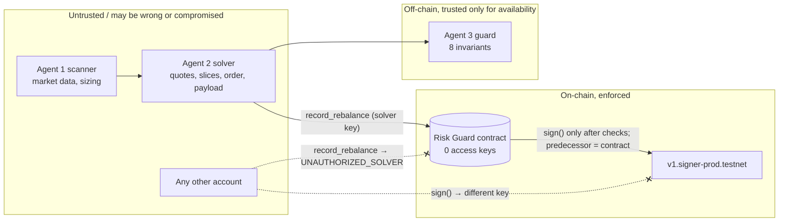

# ZeroDelta security model

This document describes what the deployed Risk Guard v2 contract ([`zerodelta-guard-fb604f.testnet`](https://testnet.nearblocks.io/address/zerodelta-guard-fb604f.testnet), source [`contracts/risk-guard/src/lib.rs`](../contracts/risk-guard/src/lib.rs)) and the off-chain swarm enforce, what they trust, and what is still open. Every "enforced" item points at the code and the test that checks it.

## 1. What is protected

| Asset | What it is | Who can use it |
|---|---|---|
| **Hedge signing key** | The secp256k1 key that NEAR Chain Signatures (`v1.signer-prod.testnet`) derives for `(predecessor = zerodelta-guard-fb604f.testnet, path = zerodelta/hedge/arbitrum)`. EVM address `0x9d5A25917b23C1CF60fD5c7695621FD3Dca754dD`. | Only code running as the contract account. The MPC network derives the key from the caller, so a call from any other account gets a *different* key. |
| **Risk policy** | `max_delta_bps 200`, `max_leverage_x100 300`, `max_slippage_bps 25`, solver id, MPC target and path. | Nobody. Set once in `new`; there is no setter, and the account has no access keys. |
| **Attestation history** | Append-only list of accepted orders with plan / intent / TEE / decision hashes and the MPC signature. | Only `record_rebalance` appends; only the private `on_mpc_signed` callback updates the MPC status of an existing entry. |

**What the key signs.** It signs `keccak256("zerodelta-hedge-v1|<contract>|<asset>|<treasury>|<spot>|<perp_short>|<perp_long>|<collateral>|<slippage>|<nonce>")`: a commitment to the approved order's parameters. It is **not** an EVM transaction hash and **not** a Hyperliquid action digest, so the signature proves contract-gated authorization but cannot be submitted to any exchange or chain as-is. A side effect: because the contract can only produce domain-separated commitments, it can never sign a transaction that moves funds held by that EVM address. See [HYPERLIQUID_EXECUTION_PATH.md](HYPERLIQUID_EXECUTION_PATH.md).

## 2. Actors and trust boundaries

| Actor | Trust | Why |
|---|---|---|
| Agent 1 (scanner) | Untrusted for safety | Can rank badly or be wrong about markets. Its output is only a proposal. |
| Agent 2 (solver) | **Untrusted.** Assumed compromisable. | It builds the order. The `spoofed_metrics` mode and three on-chain attack transactions model a lying solver. |
| Agent 3 (off-chain guard) | Defence in depth only | Runs on the web server. If it is bypassed, the contract still enforces its own checks. |
| Solver account `zerodelta-solver-fb604f.testnet` | Partially trusted | The only account allowed to call `record_rebalance`. If its key leaks, the attacker can submit any order the contract accepts (see §5). |
| Risk Guard contract | Trusted (code is public, immutable, hash-checked) | 0 access keys, verified live by `npm run verify` §9. |
| NEAR MPC network | Trusted | Standard Chain Signatures assumption: the MPC threshold is honest. |
| Price / quote sources (1Click, Hyperliquid) | Untrusted for the contract | The contract never sees prices. |

## 3. What the contract enforces on every `record_rebalance`

| # | Check | Rejection | Rust test |
|---|---|---|---|
| 1 | Caller is the registered solver | `UNAUTHORIZED_SOLVER` | `unauthorized_caller_is_rejected`, `guard_account_itself_cannot_record` |
| 2 | Payload and the four evidence hashes are 64 lowercase hex chars | `MALFORMED_HASH` | `malformed_hash_is_rejected`, `uppercase_payload_hex_is_malformed` |
| 3 | Asset symbol is 2–10 chars `A-Z0-9` (so `|` can't be injected into the preimage) | `INVALID_ORDER` | `invalid_asset_symbols_are_rejected` |
| 4 | Treasury > 0, collateral > 0, collateral ≤ treasury | `INVALID_ORDER` | `zero_treasury_and_zero_collateral_are_invalid`, `collateral_above_treasury_is_invalid` |
| 5 | `ceil(|spot + perp_long − perp_short| × 10 000 / treasury) ≤ 200`, computed **from raw legs** | `DELTA_NEUTRALITY` | `delta_exactly_at_limit_passes_one_cent_over_fails`, `rogue_10x_order_fails_on_math` |
| 6 | `ceil((spot + perp_short + perp_long) × 100 / collateral) ≤ 300` | `LEVERAGE_CEILING` | `leverage_exactly_3x_passes_one_cent_over_fails` |
| 7 | Reported slippage ≤ 25 bps | `SLIPPAGE_CEILING` | `slippage_25_passes_26_fails` |
| 8 | Payload == keccak256 of the canonical preimage of **this contract id and every order field** | `PAYLOAD_COMMITMENT_MISMATCH` | `changing_any_field_after_commitment_breaks_the_payload`, `payload_for_another_contract_is_rejected` |
| 9 | `nonce > last_nonce` | `NONCE_ALREADY_USED` | `replayed_nonce_is_rejected`, `older_nonce_is_rejected`, `nonce_zero_is_never_fresh` |
| 10 | Deposit only with an MPC request; ≥ 1 yocto with it | `MPC_DEPOSIT_REQUIRED` / `UNEXPECTED_DEPOSIT` | `mpc_sign_requires_deposit`, `deposit_without_mpc_request_is_refused` |
| 11 | Enough gas left for `sign` + callback | `INSUFFICIENT_GAS` | (runtime) |

Arithmetic uses `u128` and saturates at `u64::MAX`, so huge legs cannot wrap around into "safe" numbers (`extreme_u64_legs_do_not_overflow_and_are_rejected`). Rounding is always up. Any failed check panics, which reverts the whole receipt: nothing is stored, the nonce is not consumed, the deposit is refunded, and **no MPC receipt is created**. `npm run verify` checks that no historical rejected transaction contains a receipt to `v1.signer-prod.testnet`.

Only after all checks pass does the contract call `v1.signer-prod.testnet.sign` with the verified payload, then store the signature in `on_mpc_signed`. The approved historical transaction [DZaDDUGQ…](https://testnet.nearblocks.io/txns/DZaDDUGQQLBkdZHiZxn95NtrmeUiGrd3a7af4hn37JfV) shows the receipt `zerodelta-guard-fb604f.testnet → v1.signer-prod.testnet.sign`.

## 4. What the off-chain guard (Agent 3) adds

[`guardianAgent.ts`](../src/lib/agents/guardianAgent.ts) runs before anything would be sent:

- **Invariant 7** also checks the solver's plan against the *request* (treasury size and pair come from the orchestrator, not the solver), re-derives the raw legs from the plan, and recomputes the payload. Hostile input such as unsafe integers is rejected, never thrown.
- **Invariant 8** rejects nonces it already approved (exact set, so concurrent runs that finish out of order don't block each other), nonces at or below the contract's live `last_nonce`, and orders whose nonce timestamp is more than 5 minutes old or 60 s in the future.
- Invariants 4–6 check things the contract cannot see: the NEP-413 intent signature and recipient, the encrypted slices (each decrypts, matches its commitment, and the slices add up to the quoted order), and the (simulated) TEE attestation.

Tests: [`tests/swarm.test.ts`](../tests/swarm.test.ts), [`tests/adversarial.test.ts`](../tests/adversarial.test.ts).

## 5. What is NOT protected (trusted inputs and open findings)

The contract can only check internal consistency of what it is told. A **compromised solver key** (or a compromised server that holds it) can still:

| Gap | Example | Mitigation needed |
|---|---|---|
| **Lie about the treasury size and collateral.** | Claim a $1M treasury while the vault holds $10k. A delta-neutral order sized to $1M passes every check but is 100x the real funds. | Read balances on-chain inside the contract (vault account or intents.near balances) instead of trusting the solver. |
| **Lie about slippage.** | Report 2 bps when the real fill costs 80 bps. | Price oracle or a signed 1Click quote verified on-chain. |
| **Choose a different, still-valid order.** | Any order within 200 bps / 3x / 25 bps with a fresh nonce is accepted. | Policy is a bound, not a strategy check. |
| **Prices in general.** | The contract never sees prices; "spot = perp short" in USD is the solver's claim. | Oracle. |

Open findings in the deployed (immutable) contract. Neither puts funds at risk, because the hedge key cannot sign transactions (§1), but both are real:

- **F-1 Nonce exhaustion (liveness, medium).** `nonce` is any `u64` greater than `last_nonce`. A compromised solver key can submit one valid order with `nonce = 18446744073709551615`; after that no order can ever be accepted. The off-chain guard ties nonces to the clock (±5 min), but a stolen solver key bypasses the off-chain guard. *Fix in a future contract:* require `nonce` to be a timestamp within a window of `env::block_timestamp()`, or `nonce == last_nonce + 1`.
- **F-2 Storage exhaustion (liveness, low).** Each accepted order stores roughly 1 KB, paid from the contract account's balance. On 2026-11-09 the contract held 9.9975 NEAR with 314,883 bytes of storage, leaving about 6.85 NEAR (≈ 685 kB) free; attestation #0 is 1,049 bytes as JSON, so roughly 600 more attestations fit. A compromised solver key could fill it with valid orders, after which `record_rebalance` fails for lack of storage. *Fix:* require the caller to attach a storage deposit, or cap attestations.
- **F-3 No key rotation or pause.** The account is deliberately locked, so a leaked solver key cannot be revoked and the policy cannot be tightened. This is the trade-off for "nobody can change the rules"; a production version would use a DAO-controlled upgrade path with a timelock.

Other limits:

- **Simulated TEE.** `attestation.ts` uses real SHA-256 measurements and Ed25519 signatures, but the "enclave" key is created by the same server process. There is no hardware root of trust, so the attestation shows the binding design, not confidentiality. Order slices are really encrypted (`nacl.box`), but the server that encrypts them also holds the guard's decryption key.
- **No execution.** Settlement is a dry run: `intents.near` `simulate_intents` on mainnet (signature check, then stops at the balance check) and a prepared, unbroadcast `record_rebalance`. Dashboard clicks never create transactions.
- **Off-chain guard state** (approved nonces) is per server process. On Vercel each instance has its own set; the contract's `last_nonce` is the authoritative replay barrier.

## 6. Historical integrity

`npm run verify` §9 re-checks, against a NEAR archival RPC, that:

- the contract account has **0 access keys**, its code hash equals the committed WASM (`6VqcNeQL…`), and its policy, solver and MPC target match;
- transactions 1–2 succeeded and transaction 2 contains the contract-originated `sign` receipt whose return value equals the recorded signature;
- transactions 3–5 failed with `DELTA_NEUTRALITY`, `PAYLOAD_COMMITMENT_MISMATCH` and `NONCE_ALREADY_USED` and produced no MPC receipt;
- attestation #0 stores the same decision hash, payload and signature, and the signature recovers to the key derived for the contract.

See [VERIFICATION.md](VERIFICATION.md) for how to run it.
