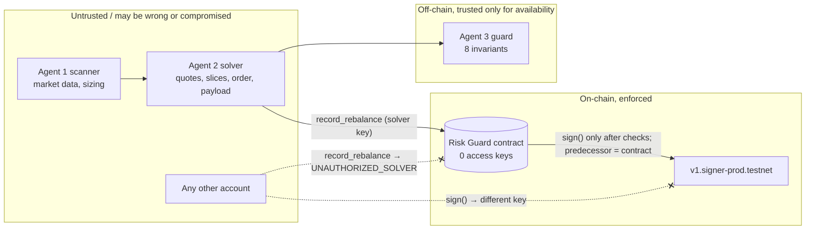

# ZeroDelta security model

Three contracts are deployed and locked on NEAR testnet. **§8 covers Risk Guard v3.1** ([`zerodelta-guard-v31-c6e71c.testnet`](https://testnet.nearblocks.io/address/zerodelta-guard-v31-c6e71c.testnet)), the current executable-signing path: it builds and signs the Hyperliquid order, caps its size in coins and bounds its expiry. **§7 covers Risk Guard v3** ([`zerodelta-guard-v3-a9c75f.testnet`](https://testnet.nearblocks.io/address/zerodelta-guard-v3-a9c75f.testnet)), which is superseded: a pre-merge audit found a size-inflation flaw in it (§7.5). §1–§6 describe v2, which the dashboard's swarm demo still talks to.

This document describes what the deployed Risk Guard v2 contract ([`zerodelta-guard-fb604f.testnet`](https://testnet.nearblocks.io/address/zerodelta-guard-fb604f.testnet), source [`contracts/risk-guard/src/lib.rs`](../contracts/risk-guard/src/lib.rs)) and the off-chain swarm enforce, what they trust, and what is still open. Every "enforced" item points at the code and the test that checks it.

## 1. What is protected

| Asset | What it is | Who can use it |
|---|---|---|
| **Hedge signing key** | The secp256k1 key that NEAR Chain Signatures (`v1.signer-prod.testnet`) derives for `(predecessor = zerodelta-guard-fb604f.testnet, path = zerodelta/hedge/arbitrum)`. EVM address `0x9d5A25917b23C1CF60fD5c7695621FD3Dca754dD`. | Only code running as the contract account. The MPC network derives the key from the caller, so a call from any other account gets a *different* key. |
| **Risk policy** | `max_delta_bps 200`, `max_leverage_x100 300`, `max_slippage_bps 25`, solver id, MPC target and path. | Nobody. Set once in `new`; there is no setter, and the account has no access keys. |
| **Attestation history** | Append-only list of accepted orders with plan / intent / TEE / decision hashes and the MPC signature. | Only `record_rebalance` appends; only the private `on_mpc_signed` callback updates the MPC status of an existing entry. |

**What the key signs.** It signs `keccak256("zerodelta-hedge-v1|<contract>|<asset>|<treasury>|<spot>|<perp_short>|<perp_long>|<collateral>|<slippage>|<nonce>")`: a commitment to the approved order's parameters. It is **not** an EVM transaction hash and **not** a Hyperliquid action digest, so the signature proves contract-gated authorization but cannot be submitted to any exchange or chain as-is. A side effect: because the contract can only produce domain-separated commitments, it can never sign a transaction that moves funds held by that EVM address. See [HYPERLIQUID_EXECUTION_PATH.md](HYPERLIQUID_EXECUTION_PATH.md).

## 2. Actors and trust boundaries

| Actor | Trust | Why |
|---|---|---|
| Agent 1 (scanner) | Untrusted for safety | Can rank badly or be wrong about markets. Its output is only a proposal. |
| Agent 2 (solver) | **Untrusted.** Assumed compromisable. | It builds the order. The `spoofed_metrics` mode and three on-chain attack transactions model a lying solver. |
| Agent 3 (off-chain guard) | Defence in depth only | Runs on the web server. If it is bypassed, the contract still enforces its own checks. |
| Solver account `zerodelta-solver-fb604f.testnet` | Partially trusted | The only account allowed to call `record_rebalance`. If its key leaks, the attacker can submit any order the contract accepts (see §5). |
| Risk Guard contract | Trusted (code is public, immutable, hash-checked) | 0 access keys, verified live by `npm run verify` §9. |
| NEAR MPC network | Trusted | Standard Chain Signatures assumption: the MPC threshold is honest. |
| Price / quote sources (1Click, Hyperliquid) | Untrusted for the contract | The contract never sees prices. |

## 3. What the contract enforces on every `record_rebalance`

| # | Check | Rejection | Rust test |
|---|---|---|---|
| 1 | Caller is the registered solver | `UNAUTHORIZED_SOLVER` | `unauthorized_caller_is_rejected`, `guard_account_itself_cannot_record` |
| 2 | Payload and the four evidence hashes are 64 lowercase hex chars | `MALFORMED_HASH` | `malformed_hash_is_rejected`, `uppercase_payload_hex_is_malformed` |
| 3 | Asset symbol is 2–10 chars `A-Z0-9` (so `|` can't be injected into the preimage) | `INVALID_ORDER` | `invalid_asset_symbols_are_rejected` |
| 4 | Treasury > 0, collateral > 0, collateral ≤ treasury | `INVALID_ORDER` | `zero_treasury_and_zero_collateral_are_invalid`, `collateral_above_treasury_is_invalid` |
| 5 | `ceil(|spot + perp_long − perp_short| × 10 000 / treasury) ≤ 200`, computed **from raw legs** | `DELTA_NEUTRALITY` | `delta_exactly_at_limit_passes_one_cent_over_fails`, `rogue_10x_order_fails_on_math` |
| 6 | `ceil((spot + perp_short + perp_long) × 100 / collateral) ≤ 300` | `LEVERAGE_CEILING` | `leverage_exactly_3x_passes_one_cent_over_fails` |
| 7 | Reported slippage ≤ 25 bps | `SLIPPAGE_CEILING` | `slippage_25_passes_26_fails` |
| 8 | Payload == keccak256 of the canonical preimage of **this contract id and every order field** | `PAYLOAD_COMMITMENT_MISMATCH` | `changing_any_field_after_commitment_breaks_the_payload`, `payload_for_another_contract_is_rejected` |
| 9 | `nonce > last_nonce` | `NONCE_ALREADY_USED` | `replayed_nonce_is_rejected`, `older_nonce_is_rejected`, `nonce_zero_is_never_fresh` |
| 10 | Deposit only with an MPC request; ≥ 1 yocto with it | `MPC_DEPOSIT_REQUIRED` / `UNEXPECTED_DEPOSIT` | `mpc_sign_requires_deposit`, `deposit_without_mpc_request_is_refused` |
| 11 | Enough gas left for `sign` + callback | `INSUFFICIENT_GAS` | (runtime) |

Arithmetic uses `u128` and saturates at `u64::MAX`, so huge legs cannot wrap around into "safe" numbers (`extreme_u64_legs_do_not_overflow_and_are_rejected`). Rounding is always up. Any failed check panics, which reverts the whole receipt: nothing is stored, the nonce is not consumed, the deposit is refunded, and **no MPC receipt is created**. `npm run verify` checks that no historical rejected transaction contains a receipt to `v1.signer-prod.testnet`.

Only after all checks pass does the contract call `v1.signer-prod.testnet.sign` with the verified payload, then store the signature in `on_mpc_signed`. The approved historical transaction [DZaDDUGQ…](https://testnet.nearblocks.io/txns/DZaDDUGQQLBkdZHiZxn95NtrmeUiGrd3a7af4hn37JfV) shows the receipt `zerodelta-guard-fb604f.testnet → v1.signer-prod.testnet.sign`.

## 4. What the off-chain guard (Agent 3) adds

[`guardianAgent.ts`](../src/lib/agents/guardianAgent.ts) runs before anything would be sent:

- **Invariant 7** also checks the solver's plan against values the solver doesn't control: the treasury size from the request, and the pair from the request (manual mode) or from Agent 1's pick (AUTO mode; Agent 1 is not trusted for strategy, only for naming what Agent 2 must build). It re-derives the raw legs from the plan and recomputes the payload. Hostile input such as unsafe integers or an unknown pair is rejected, not thrown.
- **Invariant 8** rejects nonces it already approved (exact set, so concurrent runs that finish out of order don't block each other), nonces at or below the contract's live `last_nonce`, and orders whose nonce timestamp is more than 5 minutes old or 60 s in the future. If `last_nonce` can't be read in a live run, the invariant fails (`ONCHAIN_NONCE_UNAVAILABLE`) instead of assuming 0.
- **NO_TRADE** is recorded inside the guard's signed decision (`economicRecommendation`, `signRequestWithheld`), so a risk-approved but economically withheld run can't later be mistaken for an authorization.
- Invariants 4–6 check things the contract cannot see: the NEP-413 intent signature and recipient, the encrypted slices (each decrypts, matches its commitment, and the slices add up to the quoted order), and the (simulated) TEE attestation.

Tests: [`tests/swarm.test.ts`](../tests/swarm.test.ts), [`tests/adversarial.test.ts`](../tests/adversarial.test.ts).

## 5. What is NOT protected (trusted inputs and open findings)

The contract can only check internal consistency of what it is told. A **compromised solver key** (or a compromised server that holds it) can still:

| Gap | Example | Mitigation needed |
|---|---|---|
| **Lie about the treasury size and collateral.** | Claim a $1M treasury while the vault holds $10k. A delta-neutral order sized to $1M passes every check but is 100x the real funds. | Read balances on-chain inside the contract (vault account or intents.near balances) instead of trusting the solver. |
| **Lie about slippage.** | Report 2 bps when the real fill costs 80 bps. | Price oracle or a signed 1Click quote verified on-chain. |
| **Choose a different, still-valid order.** | Any order within 200 bps / 3x / 25 bps with a fresh nonce is accepted. | Policy is a bound, not a strategy check. |
| **Prices in general.** | The contract never sees prices; "spot = perp short" in USD is the solver's claim. | Oracle. |

Open findings in the deployed (immutable) contract. Neither puts funds at risk, because the hedge key cannot sign transactions (§1), but both are real:

- **F-1 Nonce exhaustion (liveness, medium).** `nonce` is any `u64` greater than `last_nonce`. A compromised solver key can submit one valid order with `nonce = 18446744073709551615`; after that no order can ever be accepted. The off-chain guard ties nonces to the clock (±5 min), but a stolen solver key bypasses the off-chain guard. *Fix in a future contract:* require `nonce` to be a timestamp within a window of `env::block_timestamp()`, or `nonce == last_nonce + 1`.
- **F-2 Storage exhaustion (liveness, low).** Each accepted order stores roughly 1 KB, paid from the contract account's balance. On 2026-11-09 the contract held 9.9975 NEAR with 314,883 bytes of storage, leaving about 6.85 NEAR (≈ 685 kB) free; attestation #0 is 1,049 bytes as JSON, so roughly 600 more attestations fit. A compromised solver key could fill it with valid orders, after which `record_rebalance` fails for lack of storage. *Fix:* require the caller to attach a storage deposit, or cap attestations.
- **F-3 No key rotation or pause.** The account is deliberately locked, so a leaked solver key cannot be revoked and the policy cannot be tightened. This is the trade-off for "nobody can change the rules"; a production version would use a DAO-controlled upgrade path with a timelock.

Other limits:

- **Simulated TEE.** `attestation.ts` uses real SHA-256 measurements and Ed25519 signatures, but the "enclave" key is created by the same server process. There is no hardware root of trust, so the attestation shows the binding design, not confidentiality. Order slices are really encrypted (`nacl.box`), but the server that encrypts them also holds the guard's decryption key.
- **No execution.** Settlement is a dry run: `intents.near` `simulate_intents` on mainnet (signature check, then stops at the balance check) and a prepared, unbroadcast `record_rebalance`. Dashboard clicks never create transactions.
- **Off-chain guard state** (approved nonces) is per server process. On Vercel each instance has its own set; the contract's `last_nonce` is the authoritative replay barrier.

## 6. Historical integrity

`npm run verify` §9 re-checks, against a NEAR archival RPC, that:

- the contract account has **0 access keys**, its code hash equals the committed WASM (`6VqcNeQL…`), and its policy, solver and MPC target match;
- transactions 1–2 succeeded and transaction 2 contains the contract-originated `sign` receipt whose return value equals the recorded signature;
- transactions 3–5 failed with `DELTA_NEUTRALITY`, `PAYLOAD_COMMITMENT_MISMATCH` and `NONCE_ALREADY_USED` and produced no MPC receipt;
- attestation #0 stores the same decision hash, payload and signature, and the signature recovers to the key derived for the contract.

See [VERIFICATION.md](VERIFICATION.md) for how to run it.

## 7. Risk Guard v3 (superseded by v3.1, see §7.5 and §8)

Contract [`zerodelta-guard-v3-a9c75f.testnet`](https://testnet.nearblocks.io/address/zerodelta-guard-v3-a9c75f.testnet), source [`contracts/risk-guard-v3/src/lib.rs`](../contracts/risk-guard-v3/src/lib.rs), 0 access keys. Hedge key: `derived_public_key(zerodelta/hedge/hyperliquid, zerodelta-guard-v3-a9c75f.testnet)` = EVM address `0xef639b571185dc6ee0e4680de4e8dd81e7e02c66`.

### 7.1 What the v3 key signs, and what it cannot

The contract signs only the EIP-712 phantom-agent digest of an order **it built itself**: one IOC **sell** on the market index stored for the asset in the deploy-time Hyperliquid testnet table, not reduce-only, with size = approved perp short ÷ limit in whole lots. It computes the msgpack encoding, `connectionId = keccak256(msgpack(action) ‖ nonce ‖ 0x00)` and the digest on-chain. A solver-supplied `expected_digest_hex` is only compared (a mismatch rejects with `PAYLOAD_COMMITMENT_MISMATCH`); it is never signed.

So the hedge key **can sign orders only**. The code has no path to sign a Hyperliquid withdrawal, a USD transfer, an `approveAgent`, a vault action, or an EVM transaction: it cannot sign transfers or withdrawals. It can still sign orders that lose money (a bad trade can drain a funded account), which is why v3.1 caps order size. Hyperliquid testnet recovered this key's address from one such signature ([`proofs/hl-acceptance.v3.json`](../proofs/hl-acceptance.v3.json)).

### 7.2 What v3 enforces on every `sign_executable_hedge`

Each rejection has a Rust test in [`tests/adversarial.rs`](../contracts/risk-guard-v3/tests/adversarial.rs) that also checks no MPC receipt was created and the nonce wasn't consumed.

| Check | Rejection |
|---|---|
| Caller is the registered solver; four evidence hashes are 64 lowercase hex | `UNAUTHORIZED_SOLVER`, `MALFORMED_HASH` |
| Symbol is in the stored per-network market table | `UNKNOWN_MARKET`, `INVALID_ORDER` |
| v2's risk math on the raw legs; the hedge has a perp short and no perp long | `DELTA_NEUTRALITY`, `LEVERAGE_CEILING`, `SLIPPAGE_CEILING`, `INVALID_ORDER` |
| Limit within `price_band_bps` (100) of the reference; Hyperliquid price rules (integer, or ≤ 5 significant figures and ≤ 6 − szDecimals decimals) | `PRICE_OUT_OF_BAND`, `NO_REFERENCE_PRICE`, `PRICE_ZERO`, `PRICE_TOO_MANY_SIG_FIGS`, `PRICE_TOO_MANY_DECIMALS` |
| Size × limit within `notional_band_bps` (50) of the approved perp short; at least one lot; no u64 overflow | `NOTIONAL_DRIFT`, `SIZE_ZERO`, `SIZE_OVERFLOW` |
| Nonce in milliseconds: `last_nonce < nonce`, `block_ms − 300 000 ≤ nonce ≤ block_ms + 60 000`, `block_ms = block_timestamp / 10⁶` | `NONCE_ALREADY_USED`, `STALE_ORDER`, `FUTURE_NONCE` |
| Supplied digest assertion, if any, equals the contract's digest | `PAYLOAD_COMMITMENT_MISMATCH` |
| Caller attaches the attestation's storage + 384 bytes for the signature + 1 yocto MPC deposit; excess refunded | `INSUFFICIENT_DEPOSIT` |
| ≥ ~300 Tgas when signing | `INSUFFICIENT_GAS` |
| Only the contract may deliver the MPC result | `Method on_mpc_signed is private` (checked on-chain, [tx](https://testnet.nearblocks.io/txns/8pL5kKgXZkry3WVXeA2ai4Ys6nzj5BgQDUbt5CBieoSh)) |

Fifteen deliberate contract bugs (signing the solver's digest, a buy instead of a sell, sizing from the reference, no band, no storage charge, `v = rid + 28`, the mainnet source on testnet, and others) each made at least one test fail ([`MUTATION_RESULTS.md`](../contracts/risk-guard-v3/MUTATION_RESULTS.md), produced by [`contracts/mutation-test.py`](../contracts/mutation-test.py)).

### 7.3 v2 findings in v3

- **F-1 nonce exhaustion: fixed.** A `u64::MAX` nonce is `FUTURE_NONCE`, so it can't freeze the contract (`u64_max_nonce_cannot_freeze_the_contract_f1`). A v2-style microsecond nonce is also rejected as future-dated.
- **F-2 storage exhaustion: fixed.** Each accepted request pays for its own storage; the caller attaches the attestation's storage cost (on v3.1, attestation #0 added 1,151 bytes ≈ 0.0115 NEAR to the contract's storage stake, see `testnet-proof.json`), and the contract's balance pays nothing (`the_caller_pays_storage_and_the_exact_required_deposit_is_accepted_f2`).
- **F-3 no key rotation or pause: unchanged, by design.** The v3 account is locked too.

### 7.4 Trusted inputs in v3

- **Reference price (new).** `reference_px_e8` comes from the solver. A compromised solver can move the limit and the reference together, so the band only bounds the distance from the solver's own reference, not from the real market. **Because size = approved notional ÷ limit, a bad price DOES enlarge the position** (this was the v3 flaw, §7.5). v3.1 adds coin caps (§8).
- **Treasury, collateral, slippage**: as in v2 (§5).
- **Market table**: fetched from Hyperliquid testnet `meta` at deploy, compared with the pinned table (the deploy aborts on any difference) and stored immutably. If Hyperliquid re-indexed its markets, the contract would sign orders for the old index; a new deployment would be needed.
- **No funded account.** The hedge address has no Hyperliquid account, so no order can execute. Turning the key into a funded account or agent wallet is future work.

### 7.5 The v3 flaw found by the pre-merge audit

- **High: size inflation.** The limit price is only compared with a reference price the same solver supplies, and size = approved notional ÷ limit. Setting both to a fraction of the market price gets an order many times the approved size approved. Confirmed with a read-only `preview_executable_hedge` on the deployed contract: limit = reference = 46.2 gave 2× the approved size, 9.2 gave 10× (3,617 SOL, about $334k, against $33k approved). Nothing was exploited and no funds exist.
- **Medium:** hedges could stack (no cumulative cap); no `expiresAfter`, so a signature stayed valid at Hyperliquid for days.
- **Low:** a malformed MPC response left an attestation Pending; the $10 minimum order value was not enforced.
- The v3 contract is locked, so it cannot be patched. v3.1 is a new deployment; v3 and its proof stay as history.
- The v3 transaction "limit 3% from the reference → `PRICE_OUT_OF_BAND`" only demonstrates the price-band arithmetic. It is not an attack proof.

## 8. Risk Guard v3.1 (current)

### Reported-input bypass and lifecycle boundary

A compromised authorized solver can set spot to zero, the short to $80,000 and reported treasury/collateral to $800 million. A read-only call at block **277325226** returned `approved: true`, `net_delta_bps: 1`, `leverage_x100: 1` (**0.01×**, not 1×), a **38.5672 ETH** sell and no violations. Changing only treasury/collateral to $50,000 produced `DELTA_NEUTRALITY: 16000 bps > 200 bps`. This is a trust-assumption bypass, not integer overflow. The executable sell stays the same; the reported denominator changes the math. The `naked-short` preview demonstrates it using fresh nonces and current window state, never a preset verdict.

**Independently enforced restrictions:** listed market, IOC sell/non-reduce-only shape, coin caps, expiry, replay checks and contract-built digest. These do not authenticate actual holdings or guarantee delta neutrality. The MPC network and exchange behavior remain external trust assumptions.

**No lifecycle exit:** `hedge_order` always constructs `is_buy: false, reduce_only: false`; no exposed method signs a closing buy or withdrawal. Repeated windows admit additional signed volume without verifying accumulated positions. This unfunded deployment must not be treated as a complete funded carry account. A future separately deployed design needs authenticated position reconciliation, exposure limits, close-only actions and recovery. A separately controlled master account with an API wallet is a candidate architecture, not an implemented remedy.

**Quota consumption:** the contract appends the attestation before yielding to MPC, and window accounting includes records regardless of MPC status or exchange fill. Failed, withheld or unfilled attempts can consume capacity. This is an availability limitation under a compromised authorized solver; the caps deliberately measure attempted signing flow, not fills. Do not automatically release capacity on callback failure without proving no usable signature can exist.

### Existing v3.1 checks and evidence

Contract [`zerodelta-guard-v31-c6e71c.testnet`](https://testnet.nearblocks.io/address/zerodelta-guard-v31-c6e71c.testnet), source [`contracts/risk-guard-v31/src/lib.rs`](../contracts/risk-guard-v31/src/lib.rs), 0 access keys, hedge address `0xa74e082a55e862845d510f8d609d315afd859f5e`. Everything in §7.1–§7.4 applies, plus:

| Added check | Rejection |
|---|---|
| Per-market maximum order size **in coins** (BTC 1, ETH 40, SOL 800, NEAR 20,000), independent of any price | `ORDER_SIZE_CAP` |
| Per-market cumulative size over a rolling 24 h window (twice the per-order cap) | `WINDOW_SIZE_CAP` |
| At most 6 signed orders per 24 h window, any market | `WINDOW_ORDER_COUNT` |
| `expiresAfter` supplied by the solver, must be after block time and at most 1 h ahead; hashed into the order and the digest | `EXPIRED`, `EXPIRY_TOO_FAR` |
| Hyperliquid's $10 minimum order value | `ORDER_VALUE_BELOW_MIN` |
| A failed or malformed MPC response marks the attestation `Failed` instead of leaving it Pending | tested in `tests/adversarial.rs` |

On-chain proof of the audit attack: limit = reference = 1/10 of the market price gives 159.2 ETH, rejected with `ORDER_SIZE_CAP` and `WINDOW_SIZE_CAP`, no MPC receipt ([tx](https://testnet.nearblocks.io/txns/ibykqDGu99Y2kqW2xRW9kA3ot33r7usfDZTGzJ8GXHz)).

**What the guarantee is, and is not.** Individual order size and rolling signing volume are bounded in coins; outstanding positions are not tracked. The caps are fixed at deploy for the demo's $50k treasury, so they are loose for other treasuries. They do not remove the risk: a solver that halves the price gets about 2× the intended size approved if that still fits under the cap (for example 720 SOL against a cap of 800). The reference price is still a trusted solver input. An on-chain oracle would close this and was left out on purpose.

**`expiresAfter` bound.** The contract limits expiry to one hour. Hyperliquid also accepts nonces several days old, so `expiresAfter` is the only time bound the signature carries; after it passes, Hyperliquid rejects the order. An hour is a judgment call, not a derived number.

**Evidence.** 55 Rust tests; [`MUTATION_RESULTS.md`](../contracts/risk-guard-v31/MUTATION_RESULTS.md): 27 of 27 deliberate bugs caught. CI rebuilds all three contracts with pinned Rust 1.81.0 and locked dependencies, remaps dependency panic-location paths to the historical prefix, and compares every byte against the committed deployed WASM (`scripts/verify-wasm.sh`). It also checks the fixed historical hashes.

## 9. Off-chain intent and quote hardening

The guardian recomputes the NEP-413 hash from the signed bytes and uses that value for attestation and decision binding. The hash must match the solver's metadata. The orchestrator supplies `expectedSignerId` independently of the solver; a valid signature from another key is insufficient. Exactly one token-diff operation is allowed, with the complete permitted asset set, exact quoted spend and minimum receipts, no extra operations, and a finite deadline within 30 minutes. Malformed intent messages are rejected.

A missing or malformed live slice/reference quote is labelled as a fallback with `validForAuthorization: false`; the guard requires an explicit true validity marker before preparing an MPC request. Offline-model quotes are usable only for the explicit offline simulation. Live quote responses validate amounts and provider timestamps when present (60-second maximum age, five seconds future tolerance). Without a provider timestamp, freshness means the response was fetched in this run; it is not independently attested. These are off-chain checks, not new guarantees in the immutable contracts.

The contract still trusts reported holdings, collateral, slippage and reference price. Window caps limit signed order flow, not outstanding positions after the window expires. The read-only judge preview deliberately exposes a half-price proposal that can pass the cap. Independent oracle and holdings verification require a separately designed deployment.

## 10. Second review: canonical risk, quote evidence and complete histories

`computeRiskMetrics` derives net exposure from the canonical spot/long/short notionals, with the same cent rounding and ceiling arithmetic as the deployed v2 contract. Solver-provided `deltaUsd` is never used to authorize an order. The guard rejects a plan-hash mismatch and uses its own recomputed plan hash in the signed decision and prepared call.

`quoteService.ts` is a trusted in-process adapter around the live HTTP client or explicit offline model. It records a hash of every generated quote, its recipient, source mode, authorization eligibility and time under a random receipt ID. The registry is private, bounded to 2,000 entries, and evidence expires after 120 seconds. A solver receives a copy; changing a boolean, amount, source or impact does not change the trusted registry. There is no public arbitrary-evidence registration API. Quotes are also included in the software attestation's report-data hash. The guard compares individual and aggregate impact, binds quoted fill values to plan legs, and requires full quote evidence before accepting the token-diff. The client rejects minimum receipts below the requested slippage bound. Live runs cannot opt into offline evidence through HTTP input.

This adapter is trusted for quote provenance inside one server process. It does not isolate arbitrary malicious code running in that process, authenticate a dishonest provider's economics, verify hardware attestation or enforce new rules in the immutable contracts. It closes the altered-output cases from the review, not the entire server-compromise threat.

Slice validation checks origin/destination, leg ID, positive input and minimum receipts, totals against the verified quote, count and sequential unique indices, recipient key, and increasing integral release offsets within 720 seconds.

Audit v2 events hash all explanatory fields using canonical structured JSON. A guardian signature seals the final root, event count and decision hash. `verifyAuditChain` requires the expected guardian public key and decision hash; these must be authenticated by the caller (for example from the trusted application over HTTPS). The ephemeral guardian key is not an independently certified identity, and the seal is not an on-chain timestamp or permanent public anchor.

`verifyRecordedAcceptance` rebuilds the signed order digest and independently checks exactly one real request plus the two prescribed controls. It parses each raw exchange response, recomputes local recovery and classification, and checks saved metadata against those calculations. This proves internal consistency of the artifact; it does not cryptographically authenticate an unsigned historical HTTP response. The recorded evidence and deployed proof files remain unchanged.
